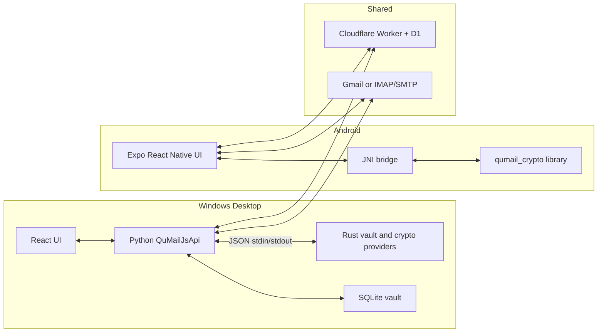

# QuMail 1.0 Stable Prototype: Codebase Audit

**Audit date:** 2026-11-17  
**Scope:** Desktop application, Android application, native Rust providers, Cloudflare directory, and ESP32 firmware documentation  
**Version audited:** 1.0.0 prototype (`version.json`, build commit `0be6cb1`)  
**Method:** Source inspection of both client codebases, native providers, directory schema and handlers, and the authoritative firmware report. Cross-platform interoperability is recorded as demonstrated by the project owner. No target code was executed for this review.

The filename is retained for link compatibility. Earlier content in this file described the codebase as production-staged. That framing is replaced by the 1.0 Stable Prototype status.

---

### Executive Summary

QuMail 1.0 is a working concept demonstration of post-quantum email with two delivery modes:

1. **PQ Mail** between enrolled QuMail clients, using OpenPGP v6 certificates with hybrid ML-DSA-65 plus Ed25519 signing and hybrid ML-KEM-768 plus X25519 encryption.
2. **WebLink** for recipients without QuMail, using AES-256-GCM and a decryption key carried in the URL fragment.

Desktop is a Python, React, and Rust application for Windows. Android is an Expo and React Native companion with a JNI bridge to the same Rust crypto core. Both clients enroll devices in a Cloudflare Worker directory and use the same message profile. Desktop to Android and Android to Desktop encrypted mail has been demonstrated.

QuMail 1.0 is not production-grade, enterprise-ready, or independently audited. It does not implement QKD. The ESP32 board is an educational noise-source demonstration, not a validated TRNG.

---

### Verified Capability Matrix

| Area | State | Evidence |
|---|---|---|
| Desktop UI | Implemented | React 19 and Vite UI in a pywebview WebView2 window. |
| Desktop mail | Implemented | Gmail OAuth 2.0 with PKCE, IMAP over TLS, SMTP with STARTTLS. |
| PQ send and receive | Implemented | `qumail-crypto-provider.exe` and `qumail-vault-provider.exe`. |
| WebLink | Implemented | `CloudDirectoryClient.create_weblink`, Worker viewer, fragment key. |
| Local vault | Implemented | SQLite records with AES-256-GCM, master key in Windows Credential Manager. |
| OAuth token storage | Implemented | Fernet tokens with a DPAPI-wrapped master key. |
| Directory | Implemented | Cloudflare Worker and D1, currently the development deployment. |
| Android PQ mail | Implemented | Expo module, JNI, `libqumail_crypto.so`. |
| Android mail transport | Implemented | Gmail REST API. |
| Cross-platform PQ mail | Demonstrated | Desktop and Android exchanged encrypted messages. |
| Hardware entropy | Demonstration | ESP32 Zener-noise sampler and serial stream. |
| QKD | Not implemented | Only a status-only ETSI 014 client and a CSPRNG simulator exist. |
| Production readiness | Not claimed | Prototype status, no external audit. |

---

### Architecture

The Desktop crypto boundary is a subprocess API with bounded JSON, an operation allowlist, and input size limits. The Android boundary is JNI with typed methods for identity generation, sealing, opening, attachment encryption, and directory proof. Native providers enforce certificate topology, algorithm choice, recipient limits, and signature verification.

---

### Cryptographic Implementation

| Element | Verified implementation |
|---|---|
| Certificate version | OpenPGP v6 |
| Primary key | Certification only, ML-DSA-65 plus Ed25519 |
| Signing subkey | ML-DSA-65 plus Ed25519, exactly one active in the device-separation topology |
| Encryption subkey | ML-KEM-768 plus X25519, exactly one active transport subkey |
| Message encryption | AES-256-GCM or OCB, SEIPD v2 |
| Signature hash | SHA-512 in the default seal path |
| Attachment encryption | Per-file AES-256-GCM with unique key and nonce |
| Directory proof | ML-DSA-65 detached signature over a canonical identity, device, fingerprint, and nonce binding |
| Profile | Experimental `M2-EXPERIMENT-RFC9980-AES256-GCM` |

The profile is experimental. QuMail clients interoperate with each other, but interoperability with unrelated PQ OpenPGP implementations is not established. Documentation must not claim RFC compliance beyond the implemented profile.

The vault provider supports generation, inspection, public export, rotation, revocation, sealing, opening, and directory proof. Rotation keeps the root fingerprint and retires old subkeys. Revocation inserts a certificate revocation.

One validation item remains: certificate generation requests the ML-DSA cipher suite for the transport-encryption subkey while policy requires an ML-KEM suite. Tests assert ML-KEM envelope output, so the effective behavior needs a generated-certificate dump. See tracking entry F2.

---

### Identity and Directory

Desktop binds a verified Google issuer and subject to a vault account. It enrolls a device by requesting a challenge, deriving the ML-DSA public key and fingerprint, signing the canonical proof message, and submitting the certificate bundle with a fresh Google ID token.

The Worker verifies the Google ID token, consumes the nonce once, checks tombstones, applies device limits, and returns an opaque session token. Session tokens are stored hashed in D1. Directory lookup requires a session and is quota-limited. Device revocation writes a tombstone and invalidates sessions.

The directory stores ciphertext for WebLinks. The AES key is appended to the URL fragment by the client and is not transmitted to the Worker. Recipient email gating uses a salted hash. Attachments are chunked and limited to 30 MB total.

A separate Flask directory in `services/directory/` implements an RFC 6962 transparency log. It is a development harness. Its rotation path does not verify the transition signature, revocation is unauthenticated, and lookup has no authentication. It must not be deployed as the production directory.

---

### Desktop Security Boundaries

| Boundary | Verified behavior |
|---|---|
| Vault at rest | AES-256-GCM with associated data. Master key in Windows Credential Manager. No fallback key. |
| OAuth tokens | Fernet with a DPAPI-wrapped key file, one token file per account. |
| Provider integrity | Provider path resolution and SHA-256 manifest check at startup. |
| Provider isolation | Separate Rust processes, bounded JSON pipes, operation allowlist. |
| Message verification | Signature, signer address, recipient or archive key, and replay history checks. |
| Contact pinning | Fingerprints are recorded and device-set changes are reported. Current build warns and re-pins instead of blocking. |
| Test mode | Test-only peer key fabrication activates under test environment markers. Must remain test-only. |

The contact-pin behavior is the most important desktop hardening item. A directory-side key substitution is not blocked at send time in the current build.

---

### Android Security Boundaries

| Boundary | Verified behavior |
|---|---|
| Secret storage | Secret certificate in SecureStore. |
| App lock | Biometrics or PIN. |
| Native crypto | Expo module plus JNI to the shared Rust library. |
| Mail | Gmail REST API with OAuth. |
| Directory | Same enrollment protocol as Desktop. |

Known gaps:

- WebLink payload keys use `Math.random()` in the current build.
- Incoming sender certificates are accepted from the directory without local pinning.
- The PIN is stored in a reversible encoding and acts as a UI gate, not a cryptographic control.
- Bridge fallbacks can return synthetic success or zero-filled proof data when the native module is missing.
- The custom IMAP/SMTP settings form has no corresponding transport implementation in the reviewed source.

These are future-development items. They do not invalidate the demonstrated mobile workflow, but they must be resolved before any production claim.

---

### Hardware and QKD

The ESP32 firmware samples a Zener-noise circuit, applies debiasing, and streams bytes over serial at 115200 baud. The authoritative report states that the circuit is not QKD and is not a validated TRNG. The schematic analysis identifies a starved Zener, an unbiased transistor, and an unbiased ADC input. The variance window affects display only, and the stream continues without a meaningful signal.

The application contains an ETSI GS QKD 014 client and a local simulator. In the current path, only the status check is called. No QKD key is requested or consumed. The entropy pool can mix hardware bytes with OS randomness, but no PQ key generation call uses the pool. Key generation uses the operating system CSPRNG.

The hardware work is a valid demonstration of an integration pathway. It is not evidence of QKD protection.

---

### Verification Status

| Check | Result |
|---|---|
| Desktop test collection | 135 test functions across 16 files. Passing count not established in this review. |
| Android test suite | None found. |
| Desktop to Android PQ mail | Demonstrated. |
| Android to Desktop PQ mail | Demonstrated. |
| Third-party PQ OpenPGP interop | Not verified. |
| Key rotation across two live clients | Not exercised. |
| Large-message behavior near the provider limit | Not exercised. |
| Hardware entropy in PQ key generation | Not connected. |
| Independent security audit | Not performed. |

---

### Corrections to the Prior Audit Text

| Prior claim | Corrected statement |
|---|---|
| "143 tests passed" | The suite collects 135 test functions in 16 files. Record the measured passing count per release. |
| "Identity keys protected by DPAPI" | Identity vault records use AES-256-GCM with a master key in Windows Credential Manager. DPAPI protects OAuth token keys and translation cache data. |
| "Vault provider implements the Windows DPAPI vault backend" | The Rust vault provider manages OpenPGP identity operations. SQLite record encryption and the Credential Manager key live in the Python vault layer. |
| "WebLink uses Ed25519 sender signature binding" | The active Desktop and Android WebLink path encrypts with AES-256-GCM and has no sender signature. An unused Ed25519 module exists. |
| "RFC 9980 compliant" | The native profile is experimental. QuMail-to-QuMail interoperability is demonstrated. External interoperability and standards compliance are not. |
| "KME/QKD integration is partial" | No QKD key path exists. Only a status-only ETSI client and a CSPRNG simulator are present. |
| "Production-staged, substantively complete" | QuMail 1.0 is a stable prototype. Production readiness is not claimed. |
| "No REST API" | The Desktop UI uses pywebview IPC. The application also uses HTTPS REST for the directory and Gmail. |
| "CLI / subprocess IPC" | The native providers exchange bounded JSON over stdin and stdout, not command-line secrets. |
| "DPAPI protects local cache databases" | Vault records use AES-256-GCM. Translation cache uses DPAPI. OAuth tokens use Fernet with a DPAPI-wrapped key. |

---

### Final Assessment

**Strengths verified in source**

- The PQ implementation is real, uses current NIST algorithms in hybrid constructions, and enforces certificate topology in native code.
- Private keys stay local. The vault master key is protected by the operating system credential store.
- The WebLink key-handling design places the key only in the URL fragment and keeps ciphertext on the server.
- The directory performs Google identity verification, single-use challenges, ML-DSA proof of possession, hashed sessions, quotas, and tombstones.
- Desktop and Android clients share a working message format and have exchanged encrypted mail.

**Limitations that define the prototype**

- No QKD and no certified hardware entropy source.
- Centralized development directory and no production operations plan.
- Android security hardening and custom mailbox support remain incomplete.
- Contact pinning is advisory on Desktop and absent on Android receive.
- No external interoperability, independent audit, or production support commitment.

**Conclusion**

QuMail 1.0 succeeds as a functional concept demonstration of post-quantum secure email with a credible two-client ecosystem. The remaining work is documented in [docs/DEVELOPMENT_TRACKING.md](docs/DEVELOPMENT_TRACKING.md) and is best treated as the next development iteration, not as a defect in the demonstrated capability.

---

*End of codebase audit for QuMail 1.0 Stable Prototype.*
