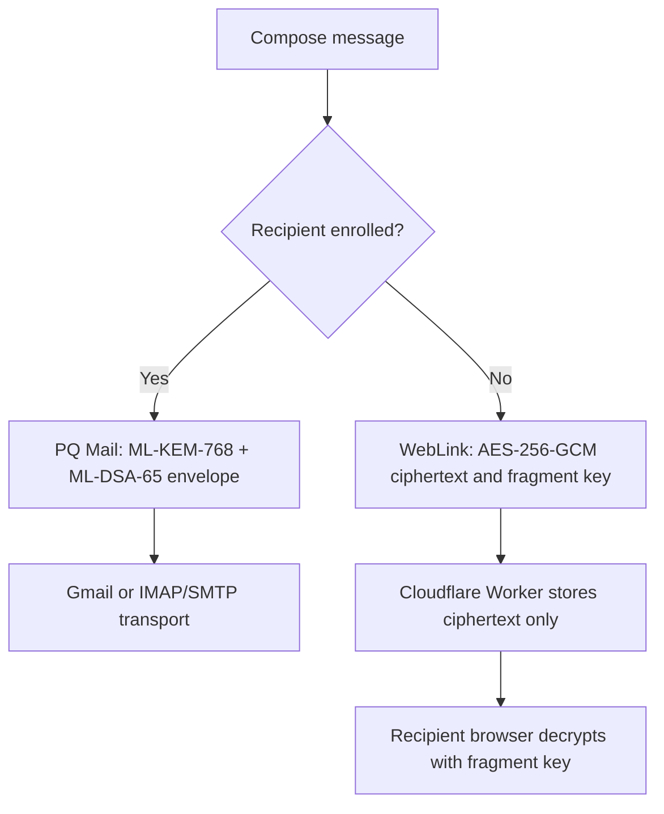

# QuMail 1.0 Stable Prototype

[](https://github.com/uzx-02/QuMail)
[](version.json)
[](native/)
[](tests/)

QuMail is a post-quantum encrypted email prototype for Windows and Android. It adds end-to-end PQ mail and zero-install encrypted WebLinks on top of Gmail OAuth or standard IMAP/SMTP accounts.

QuMail 1.0 is a stable concept demonstration. It is functional enough to show the intended product and its cross-platform design, but it is not production-grade, enterprise-ready, or independently audited. The companion Android app and Desktop app have exchanged PQ-encrypted mail in both directions.

<!-- TOC -->
- [What QuMail Does](#what-qumail-does)
- [How It Works](#how-it-works)
- [Architecture and Crypto](#architecture-and-crypto)
- [Security Model](#security-model)
- [Hardware and QKD Demonstration](#hardware-and-qkd-demonstration)
- [Android Application](#android-application)
- [Getting Started](#getting-started)
- [Configuration](#configuration)
- [Testing](#testing)
- [Known Limitations](#known-limitations)
- [Project Status](#project-status)
- [Documentation Map](#documentation-map)

---

### What QuMail Does

QuMail adds two protection modes on top of ordinary email:

| Mode | Recipient requirement | Protection |
|---|---|---|
| PQ Mail | Enrolled QuMail user | Hybrid ML-KEM-768 plus X25519 encryption, hybrid ML-DSA-65 plus Ed25519 signature, OpenPGP v6 envelope |
| WebLink | Any browser user | AES-256-GCM payload encryption, key carried in the URL fragment, optional passcode and email OTP |
| Standard | Any email recipient | Ordinary email over TLS, no QuMail payload encryption |

The Desktop client performs IMAP receive, SMTP send, local vault storage, and native cryptography. The Android client performs Gmail REST receive and send, directory enrollment, and the same PQ and WebLink message formats. Both clients use the same Cloudflare key directory.

QuMail is not a mail server, a browser extension, or a QKD system. It does not store private keys in the cloud.

---

### How It Works



#### PQ Mail

1. The sender looks up the recipient's device certificates in the QuMail directory.
2. The crypto provider seals the message to each recipient certificate and signs it with the sender's signing subkey.
3. Attachments are encrypted separately with per-file AES-256-GCM keys. The key manifest travels inside the PQ envelope.
4. The envelope is sent as an OpenPGP encrypted MIME message over the normal mail path.
5. The recipient decrypts locally and verifies the signer certificate.

#### WebLink

1. The sender generates a random 256-bit AES key and 96-bit nonce with `secrets.token_bytes`.
2. Body and attachment chunks are encrypted with AES-256-GCM.
3. Ciphertext is uploaded to the directory. The server does not receive the key.
4. The access URL carries the key in the fragment, for example `#key=<hex>`.
5. The recipient opens the link in a browser. Browser JavaScript decrypts locally.
6. Access can require a passcode or a recipient email OTP. View limits and burn-after-read are enforced by the service.

#### Standard Email

Standard mode sends ordinary MIME through Gmail or the configured IMAP/SMTP account. It does not add QuMail encryption.

---

### Architecture and Crypto

Desktop is a Python 3.12 backend with a pywebview window and a local Flask asset server. Sensitive work runs in separate Rust processes over bounded JSON pipes. Android uses Expo SDK 58 and React Native 0.88, with JNI into the shared Rust crypto library. Both clients use the same Cloudflare directory.

| Layer | Implementation |
|---|---|
| Certificate | OpenPGP v6 with a certification-only primary key |
| Signing | ML-DSA-65 plus Ed25519 composite signing subkey |
| Key encapsulation | ML-KEM-768 plus X25519 transport encryption subkey |
| Message encryption | AES-256-GCM, SEIPD v2 |
| Attachments | Per-file AES-256-GCM with a sealed manifest |
| Native engine | Sequoia-OpenPGP 2.4.1, ml-dsa, OpenSSL 3.5.9 |

The native profile identifier is experimental (`M2-EXPERIMENT-RFC9980-AES256-GCM`). Interoperability with unrelated PQ OpenPGP implementations is unverified. See [docs/ARCHITECTURE.md](docs/ARCHITECTURE.md) for message paths, trust anchors, and component detail.

---

### Security Model

#### Local key protection

- Desktop vault records use AES-256-GCM with associated data bound to the vault, account, and record revision.
- The vault master key is a 32-byte secret in Windows Credential Manager. There is no cached fallback.
- OAuth tokens use Fernet encryption with a DPAPI-wrapped master key. Translation cache data also uses DPAPI.
- Android stores the secret certificate in SecureStore and gates the app with biometrics or a PIN.

#### Directory trust

- The Worker verifies Google ID tokens before enrollment.
- Challenges are single-use and time-bounded.
- Enrollment includes an ML-DSA proof of possession bound to identity, device, fingerprint, and nonce.
- Session tokens are opaque and stored hashed in D1.
- Revoked devices create tombstones that block re-enrollment.

#### Contact pinning

Desktop records contact fingerprints and reports when a device set changes. In the current build, the change is accepted and re-pinned with a warning rather than blocking the send. See [development tracking](docs/DEVELOPMENT_TRACKING.md) entry B1.

#### WebLink handling

The directory stores ciphertext only. The AES key stays in the URL fragment, which browsers do not send in HTTP requests. Passcode mode and recipient OTP are available. The passcode derivation is a known hardening item, recorded in the tracking document.

#### What is not protected

- Standard mode is ordinary email.
- Enrolled recipients are required for PQ mail. Devices are capped per send.
- The directory is a centralized trust and availability dependency.
- QuMail 1.0 has no QKD protection and no hardware-backed PQ key generation.

---

### Hardware and QKD Demonstration

The [firmware/QuMail_TRNG_ESP32](firmware/QuMail_TRNG_ESP32) board is an educational hardware integration demonstration. It samples a Zener-noise circuit, debiases the bit stream, and streams bytes over serial. The authoritative report states that the circuit does not perform quantum key distribution and is not a validated true random number generator. Read [QuMail TRNG Demo Report](firmware/QuMail_TRNG_ESP32/QuMail%20TRNG%20Demo%20Report.md).

An ETSI GS QKD 014 client and a local simulator exist, but the current application only checks status and never consumes QKD keys. The entropy pool can mix hardware bytes with OS randomness, but PQ key generation uses the operating system CSPRNG. Future work may integrate a commercial TRNG or QKD device behind the same hardware manager seam. See [docs/ARCHITECTURE.md](docs/ARCHITECTURE.md#hardware-and-qkd-demonstration).

---

### Android Application

The Android app is a companion client, not a full port of Desktop.

| Area | Current state |
|---|---|
| Sign-in | Google OAuth and an app-password entry path |
| Mail | Gmail REST API for read and send |
| PQ mail | Send and receive through the native Rust library |
| WebLink | Create and open encrypted links |
| Directory | Enrollment, lookup, and device management |
| App lock | Biometrics and PIN |

Known Android gaps are tracked in the [development register](docs/DEVELOPMENT_TRACKING.md#4-android-application). They include CSPRNG use for WebLink keys, receive-side sender pinning, PIN storage, and custom IMAP/SMTP transport. The app remains sufficient for the 1.0 demonstration.

---

### Getting Started

#### Desktop from source

Prerequisites: Windows 10 or 11, Python 3.12, Node.js 18 or later, and the Edge WebView2 runtime.

```powershell
python -m venv .venv
```

```powershell
.venv\Scripts\Activate.ps1
```

```powershell
pip install -r packaging/requirements.txt
```

```powershell
cd frontend
npm install
npm run build
cd ..
```

```powershell
python main.py
```

Verify native providers and their SHA-256 manifest before first use.

```powershell
python main.py --check-provider
```

Run the backend against the Vite development server with `python main.py --dev`.

#### Android from source

Prerequisites: Node.js, Android Studio, and an Android device or emulator.

```powershell
cd QuMail_App
npm install
npx expo-doctor
npx expo run:android
```

The custom native crypto module requires a development build. Expo Go cannot load it.

#### Connecting accounts

For Gmail OAuth, place an authorized desktop OAuth client file at `%LOCALAPPDATA%\QuMail\config\google_client_secret.json`. For custom mailboxes, use the Custom Mailbox tab with an app password or explicit IMAP/SMTP settings.

---

### Configuration

| Variable | Purpose | Default |
|---|---|---|
| `QUMAIL_DATA_DIR` | Local data directory | `%LOCALAPPDATA%\QuMail` |
| `QUMAIL_DIRECTORY_URL` | Desktop directory endpoint | Development Worker URL |
| `QUMAIL_PROVIDER_PATH` | Native provider directory | `./bin` |

The Android directory URL is compiled into [MailTransport.ts](../QuMail_App/src/bridge/MailTransport.ts). Change it before building against a different Worker.

Enterprise policy keys live under `HKLM\Software\QuMail\Policy`: `AllowedDomains`, `BlockLegacySimulator`, and `LogLevel`.

Worker secrets are `DIRECTORY_PEPPER`, `GOOGLE_CLIENT_ID`, `TURNSTILE_SECRET_KEY`, and `BREVO_API_KEY`. Do not commit secret values.

---

### Testing

The Desktop suite covers the crypto envelope, vault lifecycle, trust engine, directory client, transports, and UI bridge.

```powershell
pytest -q
```

The Android app does not yet have an automated test suite. Run type checking before changing mobile code.

```powershell
cd QuMail_App
npx tsc --noEmit
```

Cross-platform encrypted mail has been demonstrated manually. An automated two-client interoperability test is a future item in the tracking register.

---

### Known Limitations

- QuMail 1.0 is a prototype. It has no production SLA, independent security audit, or enterprise support commitment.
- The default directory is a development Cloudflare deployment.
- PQ mail requires both parties to be enrolled. Sends are capped by device count.
- Android custom IMAP/SMTP settings are present in the UI, but the implemented mail transport is Gmail REST. Treat custom mailbox support on Android as unverified.
- Android WebLink key generation and receive-side pinning have known gaps recorded in the tracking register.
- WebLink passcode mode uses a fast derivation and should be hardened before wider use.
- The ESP32 circuit is a demonstration and is not a validated TRNG. No QKD keys protect message traffic.
- Third-party PQ OpenPGP interoperability is unverified.
- Offline translation supports Hindi and Marathi and needs a large local model download.
- The local Flask directory service is a test harness, not a deployable service.
- Test-only peer key fabrication exists for the test environment and must never be enabled in production.

---

### Project Status

QuMail 1.0 Stable Prototype closes the current development iteration. The goal is a working, inspectable concept demonstration with honest boundaries:

| Area | Status |
|---|---|
| PQ email and WebLink workflows | Working |
| Desktop and Android interoperability | Demonstrated |
| Cloud directory | Working development deployment |
| Hardware entropy | Demonstration |
| QKD | Not implemented |
| Production readiness | Not claimed |

Future work is prioritized in [docs/DEVELOPMENT_TRACKING.md](docs/DEVELOPMENT_TRACKING.md). Do not treat that register as a certification.

---

### Documentation Map

| Document | Purpose |
|---|---|
| [README.md](README.md) | Project overview, setup, and status |
| [PRODUCTION_CODEBASE_AUDIT.md](PRODUCTION_CODEBASE_AUDIT.md) | Corrected codebase audit for the 1.0 prototype (historical filename) |
| [docs/DEVELOPMENT_TRACKING.md](docs/DEVELOPMENT_TRACKING.md) | Verified limitations, validations, and future work |
| [docs/ARCHITECTURE.md](docs/ARCHITECTURE.md) | Runtime topology, message paths, trust anchors, and hardware detail |
| [AGENTS.md](AGENTS.md) | Repository agent instructions |
| [docs/agents/issue-tracker.md](docs/agents/issue-tracker.md) | Issue tracking conventions |
| [docs/agents/triage-labels.md](docs/agents/triage-labels.md) | Triage label definitions |
| [docs/agents/domain.md](docs/agents/domain.md) | Domain documentation conventions |
| [QuMail_App/README.md](../QuMail_App/README.md) | Android application guide |
| [QuMail TRNG Demo Report](firmware/QuMail_TRNG_ESP32/QuMail%20TRNG%20Demo%20Report.md) | Authoritative hardware demonstration report |
| [qumail_privacy_policy.md](qumail_privacy_policy.md) | Privacy policy |
| [qumail_terms_and_conditions.md](qumail_terms_and_conditions.md) | Terms and conditions |

---

*QuMail 1.0 Stable Prototype. Functional concept demonstration, not production software.*
