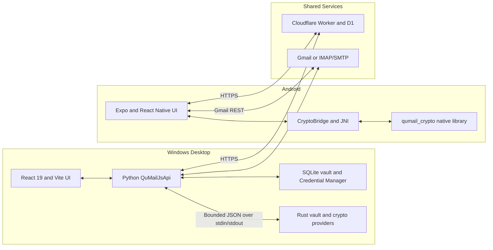

# QuMail 1.0 Architecture

Technical reference for the QuMail 1.0 Stable Prototype. It describes the runtime topology, message paths, cryptographic profile, trust anchors, and the hardware demonstration. It is not a production architecture specification.

<!-- TOC -->
- [Runtime Topology](#runtime-topology)
- [Message Paths](#message-paths)
- [Cryptographic Profile](#cryptographic-profile)
- [Trust Anchors and Key Lifecycle](#trust-anchors-and-key-lifecycle)
- [Hardware and QKD Demonstration](#hardware-and-qkd-demonstration)
- [Component Map](#component-map)

---

### Runtime Topology

Desktop runs a Python backend process that hosts a pywebview window and serves the built React assets from a local Flask server. Cryptographic operations cross a subprocess seam with an operation allowlist, bounded input, and a result envelope. Android runs a single React Native application and crosses a JNI seam into the Rust library.

The two clients share the OpenPGP v6 message format and the directory enrollment protocol. They do not share UI code or transport code.

---

### Message Paths

#### PQ Mail

1. The sender resolves recipient devices from the directory. A recipient without an active key fails the send.
2. The crypto provider validates each certificate topology, selects the transport encryption subkey, and seals the inner MIME payload with AES-256-GCM.
3. The sender signing subkey produces an ML-DSA-65 plus Ed25519 composite signature.
4. Attachments are encrypted individually with per-file AES-256-GCM keys. The manifest is placed inside the sealed payload.
5. The outer MIME message carries the OpenPGP ciphertext over Gmail or IMAP/SMTP.
6. The recipient decrypts locally, verifies the signature, checks the signer address, and records replay state on Desktop.

Sends are bounded to four recipient or device certificates. The sender's own device is normally included as an archive recipient.

#### WebLink

1. The sender generates a random 256-bit AES key and 96-bit nonce.
2. Body and attachment chunks are encrypted with AES-256-GCM.
3. The encrypted payload is uploaded to the Cloudflare Worker and stored in D1.
4. The access URL carries the key in the fragment, for example `#key=<hex>`.
5. The recipient opens the link in a browser. The viewer reads the fragment and decrypts with WebCrypto.
6. Optional recipient email OTP and passcode gates are enforced by the service. View limits and burn-after-read are stored with the link.

The server stores ciphertext and access metadata. It does not receive the fragment key.

---

### Cryptographic Profile

| Layer | Implementation |
|---|---|
| Certificate | OpenPGP v6, certification-only primary key |
| Signing subkey | ML-DSA-65 plus Ed25519 |
| Encryption subkey | ML-KEM-768 plus X25519 |
| Message encryption | AES-256-GCM or OCB, SEIPD v2 |
| Default signature hash | SHA-512 |
| Attachment encryption | Per-file AES-256-GCM with unique key and nonce |
| Native engine | Sequoia-OpenPGP 2.4.1, ml-dsa 0.1.2, OpenSSL 3.5.9 |
| Profile identifier | `M2-EXPERIMENT-RFC9980-AES256-GCM` |

The profile is experimental. QuMail clients interoperate with each other. Interoperability with unrelated PQ OpenPGP implementations is unverified.

The vault provider enforces certificate topology. A certificate uses a certification-only primary key, exactly one active signing subkey, and exactly one active transport encryption subkey. Rotation retires old subkeys while keeping the root fingerprint. Revocation inserts a certificate revocation.

---

### Trust Anchors and Key Lifecycle

| Anchor | Role |
|---|---|
| Google OIDC identity | Binds a directory account to a verified Google subject |
| Directory challenge | Single-use nonce with a short lifetime |
| ML-DSA proof of possession | Proves control of the device signing key during enrollment |
| Opaque session token | Authenticates directory operations after enrollment |
| Contact pin | Records a correspondent fingerprint on first use |
| Vault master key | Unlocks local vault records on the Desktop |

Desktop binds the verified Google issuer and subject to a vault account and refuses to inherit an account bound to a different subject. Device revocation creates a tombstone and invalidates sessions.

Contact pinning is present on Desktop and advisory during send in the current build. Android receive does not pin sender fingerprints. Both behaviors are tracked in [DEVELOPMENT_TRACKING.md](DEVELOPMENT_TRACKING.md).

---

### Hardware and QKD Demonstration

The `firmware/QuMail_TRNG_ESP32` project is an educational hardware integration demonstration. It samples a Zener-noise circuit on an ESP32 ADC, applies an adaptive baseline and variance estimate, produces a raw bit from the comparator decision, and applies Von Neumann debiasing before streaming bytes over serial at 115200 baud.

The authoritative report states that the circuit does not perform quantum key distribution and is not a validated true random number generator. Its schematic analysis identifies a starved Zener diode, an unbiased transistor, and an unbiased ADC input, which makes pickup noise a plausible source. The variance window affects the display only. The stream continues when no meaningful signal is present, and there are no on-device health tests.

Software support:

| Component | Current behavior |
|---|---|
| Serial TRNG reader | Detects a COM port and ingests bytes into an entropy pool |
| Health monitor | Applies repetition and adaptive proportion style checks plus Shannon thresholds |
| Conditioning | Mixes OS entropy with hardware bytes through HMAC-SHA256 |
| ETSI GS QKD 014 client | Implements status and key request methods; only status is called |
| QKD simulator | Produces keys from `secrets.token_bytes` |
| PQ key generation | Uses the operating system CSPRNG, not the hardware pool |

The hardware path demonstrates an integration seam. It does not add a security guarantee to PQ key generation and does not implement QKD.

A future integration should target a commercial TRNG or QKD key-delivery device with device authentication, provenance records, health tests, and a documented fallback policy. The existing hardware manager is the intended seam.

---

### Component Map

| Component | Responsibility |
|---|---|
| `launch_react_desktop.py` | Desktop bridge, account session, send and receive orchestration |
| `core/crypto_envelope` | Provider subprocess client and message verification |
| `core/vault` | Encrypted local vault, lifecycle operations, recovery |
| `core/cloud_directory.py` | Directory client and contact pin store |
| `core/hsm` | Serial, ETSI QKD, and entropy pool coordination |
| `native/vault_provider` | Certificate lifecycle and directory proof |
| `native/crypto_provider` | Production seal, open, and envelope inspection |
| `native/unified_crypto` | Android JNI library with the shared crypto core |
| `cloud_directory` | Worker, D1 schema, WebLink viewer, and migrations |
| `QuMail_App/src/bridge` | Android native, vault, and mail bridges |
| `services/directory` | Development Flask directory and Merkle log harness |

---

*See [README.md](../README.md) for setup and status, and [DEVELOPMENT_TRACKING.md](DEVELOPMENT_TRACKING.md) for limitations and future work.*
