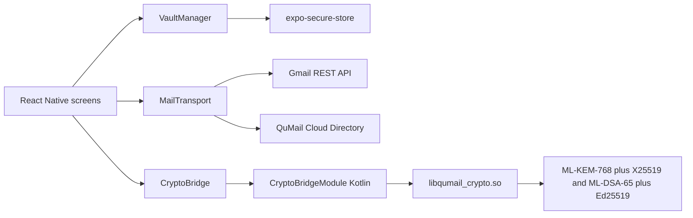

# QuMail Android

Android companion client for the QuMail 1.0 Stable Prototype. It provides post-quantum encrypted email and encrypted WebLinks on a mobile device and interoperates with the Windows Desktop client.

This is a demonstration application. It is not production-grade or independently audited.

<!-- TOC -->
- [What Works](#what-works)
- [Architecture](#architecture)
- [Setup](#setup)
- [Configuration](#configuration)
- [Security Posture](#security-posture)
- [Known Limitations](#known-limitations)
- [Project Status](#project-status)
- [Related Documentation](#related-documentation)

---

### What Works

| Capability | State | Implementation |
|---|---|---|
| Google sign-in | Working | `expo-auth-session` with the Gmail modify and send scopes |
| Gmail receive | Working | Gmail REST API |
| Gmail send | Working | Gmail REST API |
| Directory enrollment | Working | Challenge, ML-DSA proof of possession, Google token, device record |
| PQ mail send | Working | Native seal to up to four recipient certificates |
| PQ mail receive | Working | Native open and signature verification |
| WebLink create | Working | AES-256-GCM through the native bridge |
| WebLink access | Working | Recipient opens the link in a browser with the fragment key |
| App lock | Working | Biometrics or PIN |
| Cross-platform PQ mail | Demonstrated | Desktop to Android and Android to Desktop messages exchanged |

The app uses Expo SDK 58, React Native 0.88, the New Architecture, and a custom Expo module that loads the shared Rust crypto library built for Android.

---

### Architecture



| Path | Responsibility |
|---|---|
| `App.tsx` | Application shell, folders, compose, reading pane, lock state |
| [CryptoBridge.ts](src/bridge/CryptoBridge.ts) | Typed wrapper over the native module |
| [VaultManager.ts](src/bridge/VaultManager.ts) | Identity initialization, SecureStore, biometric and PIN gates |
| [MailTransport.ts](src/bridge/MailTransport.ts) | Google OAuth, Gmail REST, directory enrollment, PQ and WebLink send |
| [modules/android-bridge](modules/android-bridge) | Kotlin module plus JNI declarations |
| `src/components` and `src/screens` | UI components and screens |

The cryptographic format matches the Desktop profile: an OpenPGP v6 certificate with hybrid signing and encryption, AES-256-GCM payloads, and ML-DSA directory proof.

---

### Setup

Prerequisites: Node.js, Android Studio, Android SDK, and a device or emulator.

```powershell
npm install
```

```powershell
npx expo-doctor
```

```powershell
npx expo run:android
```

The native crypto module requires a development build. Expo Go cannot load `libqumail_crypto.so`.

Run the type checker before submitting changes.

```powershell
npx tsc --noEmit
```

There is currently no automated test suite in this project.

---

### Configuration

| Setting | Location | Notes |
|---|---|---|
| Directory endpoint | [MailTransport.ts](src/bridge/MailTransport.ts) | Compiled Worker URL. Change before building against another deployment. |
| Google OAuth client | [app.json](app.json) scheme and [types](src/types/index.ts) default client ID | Replace with your own client configuration for a distributable build. |
| Android package | `com.qumail` | Set in [app.json](app.json). |
| Native crypto library | [modules/android-bridge](modules/android-bridge) | Built from the Desktop Rust crypto core. |

Do not commit OAuth secrets or directory secrets. The app uses public client identifiers only.

---

### Security Posture

Implemented:

- Secret certificate stored through SecureStore.
- Biometric or PIN app unlock.
- Native key operations through JNI. The secret certificate does not need to be used in JavaScript for every operation.
- Directory enrollment bound to a Google identity and an ML-DSA proof of possession.
- PQ signature verification on receive.

Recorded gaps for future work:

- WebLink keys currently use `Math.random()`. Replace with `expo-crypto` or a native CSPRNG call.
- Received sender certificates are not pinned locally. A compromised directory could present a different sender certificate.
- The PIN is stored in a reversible encoding and is a UI gate, not a cryptographic control.
- Bridge fallbacks can return synthetic success when the native module is unavailable.
- Custom IMAP and SMTP settings exist in the UI, but the implemented transport is Gmail REST.

Full details and priorities are in the Desktop repository's development register: `../QuMail/docs/DEVELOPMENT_TRACKING.md`.

---

### Known Limitations

- Android is a companion client. Some Desktop features are not present.
- Gmail REST is the implemented mail transport. Custom mailbox support is not verified.
- PQ sends are capped at four recipient certificates by the shared crypto format.
- iOS is untested.
- The directory is a development deployment.
- No QKD protection. The hardware demonstration is a separate Desktop-side project.
- The app has no automated test or CI pipeline yet.

These limitations are acceptable for the 1.0 demonstration and are tracked for the next iteration.

---

### Project Status

QuMail Android 1.0 is part of the QuMail 1.0 Stable Prototype. It demonstrates mobile accessibility to the PQ mail and WebLink workflows and has exchanged encrypted mail with the Desktop client in both directions.

It is not production software.

---

### Related Documentation

| Document | Location |
|---|---|
| QuMail project overview | `../QuMail/README.md` |
| Architecture reference | `../QuMail/docs/ARCHITECTURE.md` |
| Codebase audit | `../QuMail/PRODUCTION_CODEBASE_AUDIT.md` |
| Development tracking register | `../QuMail/docs/DEVELOPMENT_TRACKING.md` |
| Firmware demonstration report | `../QuMail/firmware/QuMail_TRNG_ESP32/QuMail TRNG Demo Report.md` |
| License | `LICENSE` |
