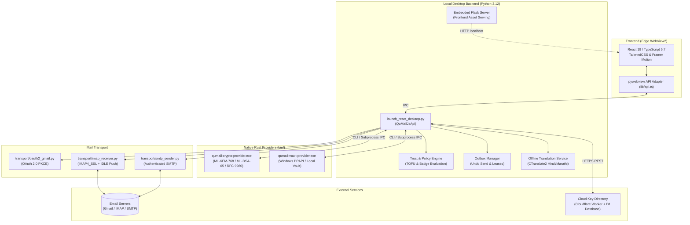

# QuMail

[](https://microsoft.com/windows)
[](https://python.org)
[](version.json)
[](bin/manifest.json)
[](tests/)

QuMail is a Windows desktop email client that provides post-quantum cryptographic security and zero-install encrypted web delivery on top of standard email accounts (Gmail via OAuth 2.0 and custom IMAP/SMTP mailboxes).

---

## Table of Contents

- [Overview](#overview)
- [How It Works](#how-it-works)
  - [Pillar 1: Post-Quantum Email (PQ Mail)](#pillar-1-post-quantum-email-pq-mail)
  - [Pillar 2: Encrypted WebLinks](#pillar-2-encrypted-weblinks)
- [System Architecture](#system-architecture)
- [Key Features](#key-features)
- [Technology Stack](#technology-stack)
- [System Requirements](#system-requirements)
- [Installation & Setup](#installation--setup)
  - [Running from Source](#running-from-source)
  - [Development Mode](#development-mode)
  - [Verifying Native Cryptographic Providers](#verifying-native-cryptographic-providers)
  - [Configuring Mail Accounts](#configuring-mail-accounts)
- [Configuration Reference](#configuration-reference)
- [Security Model & Guarantees](#security-model--guarantees)
- [Known Limitations](#known-limitations)
- [Running the Test Suite](#running-the-test-suite)
- [Audit & Compliance](#audit--compliance)

---

## Overview

Traditional public-key cryptography (RSA, ECDH, ECDSA) relies on mathematical problems that quantum computers running Shor's algorithm are expected to break. Furthermore, standard email protocols (MIME over SMTP/IMAP) transmit message headers, bodies, and attachments in formats readable by intervening relays and hosting providers.

**QuMail** addresses these challenges directly on the client side:
- Operates as a native Windows desktop client with local key generation and vault storage.
- Encrypts end-to-end between enrolled QuMail endpoints using NIST-standardized post-quantum algorithms (**ML-KEM-768** and **ML-DSA-65**).
- Delivers encrypted emails to non-enrolled recipients via **Encrypted WebLinks** using client-side **AES-256-GCM**, where the decryption key resides solely in the URL fragment and is never transmitted to the host.
- Connects directly to existing email infrastructures (Gmail, Outlook, Yahoo, Zoho, iCloud, or private IMAP/SMTP servers).

---

## How It Works

QuMail implements two complementary security modes depending on whether the recipient is registered in the QuMail Cloud Directory:

```
                  ┌───────────────────────┐
                  │ Outbound Message Sent │
                  └───────────┬───────────┘
                              │
               Recipient enrolled in Directory?
                             / \
                       YES  /   \  NO
                           /     \
  ┌───────────────────────────┐   ┌───────────────────────────┐
  │         PQ Mail           │   │      Encrypted WebLink    │
  │  • ML-KEM-768 encapsulation│   │  • AES-256-GCM ciphertext │
  │  • ML-DSA-65 signature    │   │  • RFC 3986 fragment key  │
  │  • RFC 9980 MIME payload  │   │  • Server never sees key  │
  │  • Full E2EE Mail client  │   │  • Zero-install recipient │
  └───────────────────────────┘   └───────────────────────────┘
```

### Pillar 1: Post-Quantum Email (PQ Mail)
*For communication between enrolled QuMail users.*
1. **Public Key Discovery**: When composing to a recipient, QuMail queries the Cloud Directory for the recipient's ML-KEM-768 and ML-DSA-65 public key bundle.
2. **Key Encapsulation & Signing**: The native Rust provider (`qumail-crypto-provider.exe`) performs key encapsulation via ML-KEM-768 and signs the message content with the sender's ML-DSA-65 private key.
3. **MIME Packaging**: Encrypted message contents are formatted according to **RFC 3156 / RFC 9980** standards.
4. **Transport**: The message is delivered over normal SMTP/IMAP channels. Intermediary mail servers observe only ciphertext and cloaked headers.
5. **Decapsulation & Verification**: The recipient's QuMail client decapsulates the shared secret using their local private key and verifies the sender's post-quantum digital signature.

### Pillar 2: Encrypted WebLinks
*For secure communication with recipients who do not have QuMail installed.*
1. **Local Key Generation**: QuMail generates an ephemeral 256-bit symmetric key (`os.urandom(32)`) on the sender's device.
2. **Client-Side Encryption**: Message body and attachments are encrypted using **AES-256-GCM**. The ciphertext is bound to an Ed25519 sender signature.
3. **Payload Storage**: Ciphertext and metadata are uploaded over HTTPS to the Cloudflare Worker storage backend.
4. **Fragment-Embedded Key**: QuMail constructs an access link containing the key in the RFC 3986 URL fragment:
   `https://<directory-domain>/view/<id>#key=<base64-aes-key>`
   *(Browsers do not transmit URL fragments to servers in HTTP requests; the key never touches the directory server).*
5. **Browser Decryption**: The recipient opens the URL in any standard web browser. Client-side JavaScript reads the fragment, decrypts the payload, and renders the message.
6. **Access Controls**: Senders can enforce **Burn-After-Read** (single-use limit) and separate email **OTP verification**.

---

## System Architecture

QuMail is structured as a modular desktop system: a React 19 frontend rendered inside an Edge WebView2 container, communicating via an asynchronous IPC bridge with a local Python backend that delegates cryptographic operations to native Rust binaries.



---

## Key Features

### Security & Cryptography
- **NIST Post-Quantum Cryptography**: Implements ML-KEM-768 (FIPS 203) for key encapsulation and ML-DSA-65 (FIPS 204) for digital signatures.
- **RFC 9980 / RFC 3156 Compliance**: Adheres to OpenPGP Post-Quantum MIME specifications.
- **Windows DPAPI Protection**: Identity keys, tokens, and local cache databases are protected at rest via the Windows Data Protection API.
- **Process & Binary Mitigations**: Native Rust binaries are compiled with Control Flow Guard (CFG), High Entropy ASLR, DEP/NX, and are verified by SHA-256 manifests on startup.
- **TOFU Contact Pinning**: Enforces Trust-On-First-Use key pinning; alerts the user with `CHANGED_KEY_BLOCKED` if an enrolled correspondent's key fingerprint changes unexpectedly.
- **Vault Auto-Lock**: Optional user security PIN with lockout cooldown to seal key stores on idle timeout.

### Email Operations
- **Dual Account Support**: Sign in using Google OAuth 2.0 (with PKCE) or standard IMAP/SMTP accounts (Outlook, Yahoo, Zoho, iCloud, custom domains).
- **Live IMAP IDLE Push**: Immediate notification and background synchronization of incoming mail.
- **Undo Send**: Configurable outbox delay window with cancellation countdown.
- **Subject Cloaking**: Optional obfuscation of email subject lines in transit for PQ-encrypted messages.
- **Encrypted Attachment Pipeline**: Per-file AES-256-GCM cache with path traversal protection and filename sanitization.

### User Experience
- **First-Run Onboarding Tour**: Non-intrusive 8-step interactive tour for initial setup, with re-entry available via the Help menu.
- **Offline Translation**: Local machine translation for Hindi and Marathi using CTranslate2, operating on isolated hardware without network transmission.
- **Multilingual UI**: Full interface localization in English, Hindi, and Marathi.
- **Security Indicator Badges**: Instant visual feedback on email status (`SECURED`, `ENCRYPTED_UNVERIFIED`, `EXTERNAL_CORRESPONDENT`, `SIGNATURE_INVALID`, `KEY_REVOKED_OR_EXPIRED`).

---

## Technology Stack

| Layer | Component | Version / Specification |
|---|---|---|
| **Operating System** | Windows | 10 / 11 (64-bit) |
| **Desktop Container** | Microsoft Edge WebView2 + pywebview | Edge Chromium runtime / pywebview ≥ 5.4.1 |
| **Frontend UI** | React, TypeScript, Vite, TailwindCSS | React 19, TS 5.7, Vite 6, Tailwind 3 |
| **UI Motion & Icons** | Framer Motion, Lucide, React UseAnimations | framer-motion ^12, lucide-react ^0.475 |
| **Backend Runtime** | Python | 3.12 (64-bit) |
| **Internal HTTP Host** | Flask | 3.1.3 |
| **Native Cryptography** | Rust | Sequoia-OpenPGP 2.4.1, OpenSSL 3.5.9, ml-dsa 0.1.2 |
| **PQ Primitives** | NIST FIPS 203 / 204 | ML-KEM-768, ML-DSA-65 |
| **Symmetric Crypto** | AES-GCM / Ed25519 / Fernet | cryptography 50.0.2 |
| **Local Translation** | CTranslate2 + SentencePiece | ctranslate2 ≥ 4.0.0, sentencepiece ≥ 0.2.0 |
| **Cloud Directory** | Cloudflare Workers + D1 SQLite | Serverless edge API + HMAC-SHA256 hashed lookups |

---

## System Requirements

- **Operating System**: Windows 10 (version 1903+) or Windows 11, 64-bit.
- **Web Runtime**: Microsoft Edge WebView2 Runtime (standard on modern Windows 10/11 installations).
- **RAM**: Minimum 2 GB (4 GB recommended if using the Offline Translation feature).
- **Disk Space**: ~500 MB base install (+ ~600 MB optional for offline translation model packages).
- **Network**: Internet connection required for email synchronization and cloud directory lookups.

---

## Installation & Setup

### Running from Source

#### 1. Clone the Repository
```powershell
git clone https://github.com/<your-org>/QuMail.git
cd QuMail
```

#### 2. Build the Frontend Assets
Ensure Node.js (18+ LTS) is installed, then compile the React client:
```powershell
cd frontend
npm install
npm run build
cd ..
```

#### 3. Set Up Python Virtual Environment
Python 3.12 is recommended:
```powershell
python -m venv .venv
.venv\Scripts\Activate.ps1
pip install -r packaging/requirements.txt
```

#### 4. Launch the Application
```powershell
python main.py
```
*Alternatively, double-click `Launch-QuMail-Modern.bat` to launch.*

---

### Development Mode

To run QuMail with live hot-reloading for frontend modifications:

1. In one terminal, start the Vite development server:
   ```powershell
   cd frontend
   npm run dev
   ```
2. In a second terminal, launch the desktop wrapper targeting the dev server:
   ```powershell
   python main.py --dev
   ```

---

### Verifying Native Cryptographic Providers

QuMail includes compiled native Rust cryptographic binaries located in `bin/`. To verify provider existence and SHA-256 digest integrity:

```powershell
python main.py --check-provider
```

To recompile the native providers from source with Windows Control Flow Guard (requires Rust nightly and MSVC C++ Build Tools):
```powershell
powershell -ExecutionPolicy Bypass -File tools/build_providers.ps1
```

---

### Configuring Mail Accounts

#### Google OAuth 2.0 (Gmail)
To enable official Gmail OAuth sign-in:
1. Obtain an authorized OAuth 2.0 Client ID (Desktop Application) from the [Google Cloud Console](https://console.cloud.google.com/).
2. Place your credentials JSON file at:
   `%LOCALAPPDATA%\QuMail\config\google_client_secret.json`
3. Launch QuMail and click **Sign in with Google**. Complete authentication in the browser callback.

#### Custom Mailboxes (IMAP / SMTP)
QuMail supports standard IMAP/SMTP accounts via App Passwords:
1. Open QuMail and navigate to the **Custom Mailbox** sign-in tab.
2. Enter your email address and App Password. QuMail automatically provisions host and port settings for common providers (Gmail, Outlook/Office365, Yahoo, Zoho, iCloud).
3. Custom ports and hostnames can be entered manually for private/corporate mail servers.

---

## Configuration Reference

The application behavior can be customized via environment variables:

| Variable | Description | Default |
|---|---|---|
| `QUMAIL_DATA_DIR` | Base directory for local databases, account tokens, and vault | `%LOCALAPPDATA%\QuMail` |
| `QUMAIL_DIRECTORY_URL` | Public API endpoint of the Cloud Directory Worker | `https://qumail-directory-dev.uzair-shaikh-sec-e24.workers.dev` |
| `QUMAIL_PROVIDER_PATH` | Explicit directory path to override native Rust binaries | `./bin` |

### Windows Enterprise Policy
Organizational constraints can be deployed using the Windows Registry under `HKLM\Software\QuMail\Policy`:
- `AllowedDomains` (REG_MULTI_SZ): Restricts outbound and inbound mail exclusively to specified domains.
- `BlockLegacySimulator` (REG_DWORD): Disables testing mocks and simulator modes in production environments.
- `LogLevel` (REG_SZ): Forces minimum logging thresholds (`INFO`, `WARN`, `ERROR`).

---

## Security Model & Guarantees

### Key Isolation
- **No Private Key Transmission**: Private keys for ML-KEM-768, ML-DSA-65, and Ed25519 are generated locally and never leave the device.
- **DPAPI Vault Storage**: Private keys and OAuth refresh tokens are encrypted at rest using the Windows DPAPI mechanism, tying access directly to the authenticated Windows user profile.

### Zero-Knowledge Cloud Directory
- **Hashed Identifiers**: The Cloudflare D1 database indexes accounts using `HMAC-SHA256(email, DIRECTORY_PEPPER)`. Raw email addresses are not stored.
- **Ephemeral WebLinks**: WebLink payloads stored in the cloud are AES-256-GCM ciphertexts. The decryption key exists solely in the URL fragment (`#key=...`), which is never included in HTTP requests sent to the server.
- **Tombstone Retention**: Revoked public keys are retained in a tombstone list for 90 days to prevent unauthorized re-registration of decommissioned fingerprints.

---

## Known Limitations

- **Platform Support**: QuMail is designed specifically for Windows (due to DPAPI, Edge WebView2, and Windows security mitigations). macOS and Linux are not supported.
- **Closed-Loop PQ Encrypted Mail**: Both sender and recipient must be registered QuMail users to use direct Post-Quantum MIME encryption. Non-registered recipients must be messaged via the WebLink protocol.
- **Centralized Directory Dependency**: Key exchange and WebLink routing rely on the deployed Cloudflare Worker infrastructure.
- **Offline Translation Constraints**: The local CTranslate2 translation engine currently supports Hindi and Marathi models and requires an initial ~300–600 MB model download.

---

## Running the Test Suite

The test suite validates cryptographic pipelines, IMAP/SMTP transport modules, outbox reconciliation, and trust engine decisions:

```powershell
# Run the complete test suite
pytest -q

# Run specific functional test categories
pytest tests/test_crypto_pipeline.py -v
pytest tests/test_trust_engine.py -v
pytest tests/test_outbox_manager.py -v
```

*All 143 unit and integration tests passed cleanly at the time of the 1.0.0 milestone audit.*

---

## Audit & Compliance

A complete, line-by-line verification audit of the current production codebase is available in [PRODUCTION_CODEBASE_AUDIT.md](PRODUCTION_CODEBASE_AUDIT.md). The audit details:
- Complete component inventories and verification traces.
- Cryptographic primitive implementations and standards references.
- Step-by-step transaction walkthroughs.
- Detailed architectural and data flow diagrams.
