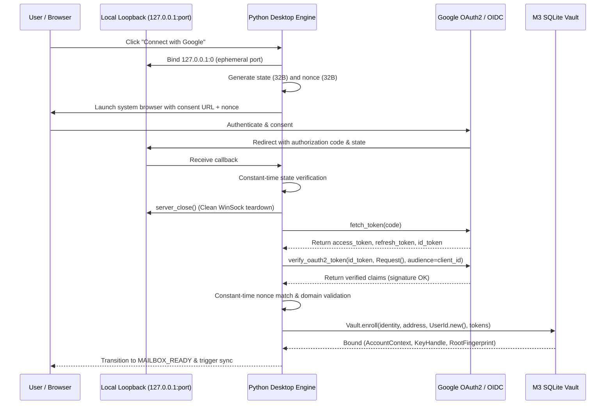

# QuMail Desktop Authentication & Session Lifecycle Architecture

## 1. Executive Summary

This specification governs the authoritative authentication and session lifecycle architecture for the QuMail 1.0 desktop application on Windows 11 x64 (React 19 + Microsoft Edge WebView2 + Python 3.12 + Rust native providers).

Under this architecture:
- The **M3 encrypted SQLite vault** (`experiments/m3/vault.py`) is the sole local authority for user identity, ML-KEM-768/ML-DSA-65 key material, and enrolled accounts.
- **Unverified JWT payloads are strictly forbidden** as identity authorities. An unverified JWT string decoded via `base64` or `jwt.decode` without cryptographic signature verification against Google's public keys will never establish an account or release plaintext.
- The React desktop presentation layer receives only safe public metadata (address, display name, fingerprint, algorithm names, session states) and never receives private keys, raw tokens, or master encryption keys.

---

## 2. Desktop Google OAuth 2.0 PKCE Lifecycle

### 2.1 Configuration Selection and Structural Validation
Google Cloud Console OAuth 2.0 credentials are validated via `core/config.py::validate_google_client_config()`:
1. **Desktop Client Requirement:** Only `"installed"` (Desktop app) client configurations supporting loopback redirect URIs are accepted.
2. **Service Account Rejection:** Service account keys (`"type": "service_account"`) are rejected immediately with user guidance to create a Desktop Client ID in Google Cloud Console.
3. **Web Application Rejection:** Web client configurations lacking local loopback URIs (`"web"` without `"installed"`) are rejected with explicit instructions on navigating to Google Cloud Console > APIs & Services > Credentials > Create Credentials > OAuth client ID > Application type 'Desktop app'.
4. **Canonical Configuration Persistence:** Validated configurations are normalized and persisted to `%LOCALAPPDATA%\QuMail\config\google_client_secret.json`.

### 2.2 Dedicated Loopback Server Architecture
The loopback listener in `transport/oauth2_gmail.py` enforces the following security invariants:
- **Binding:** Bound strictly to IPv4 `127.0.0.1` on an OS-assigned ephemeral port (`('127.0.0.1', 0)`).
- **State Security:** A 32-byte URL-safe cryptographic state parameter (`secrets.token_urlsafe(32)`) is generated and verified with constant-time equality (`secrets.compare_digest`) on callback.
- **Nonce Security:** A 32-byte URL-safe nonce (`secrets.token_urlsafe(32)`) is generated, sent in the authorization URL, and verified against the ID token JWT claim.
- **Socket Teardown:** The loopback HTTP server socket is closed completely via `server.server_close()` *before* invoking `flow.fetch_token()`, guaranteeing zero port collision or WinSock reset interference with outbound HTTPS.



---

## 3. Cryptographic Identity Verification

### 3.1 Strict Signature and Claim Verification
`transport/oauth2_gmail.py::authorize_google_account()` performs cryptographic validation:
```python
from google.oauth2 import id_token as google_id_token
from google.auth.transport.requests import Request as GoogleRequest

verified_claims = google_id_token.verify_oauth2_token(
    id_token,
    GoogleRequest(),
    audience=client_id,
)
```
The following claim checks are strictly enforced:
- **Signature:** Validated against Google's published public keys (`https://www.googleapis.com/oauth2/v3/certs`).
- **Audience (`aud`):** Strictly matches the client configuration `client_id`.
- **Issuer (`iss`):** Must be `accounts.google.com` or `https://accounts.google.com`.
- **Email Verified (`email_verified`):** Must be boolean `True`.
- **Expiration (`exp`):** Must be strictly greater than current UTC time (`int(exp) > int(time.time())`).
- **Nonce (`nonce`):** Constant-time match with request nonce (`secrets.compare_digest(claims['nonce'], nonce)`).
- **Domain Verification:** For non-`gmail.com` addresses, the hosted domain claim (`hd`) must match the domain portion of the email address (`claims.get('hd') == domain`). Domain aliases fail closed.

### 3.2 M3 Vault Enrollment
Upon verification, claims are converted into an authoritative `VerifiedProviderIdentity` via `experiments.m3.identity.validated_google_claims()` and submitted to `Vault.enroll()`:
- `qumail-m3-provider.exe` generates new root identity keypairs (ML-KEM-768 and ML-DSA-65).
- Account record is encrypted with AES-256-GCM under the OS-credential-store-backed vault master key.
- OAuth access, refresh tokens, and scopes are stored securely within the encrypted account row.

---

## 4. Authoritative Session State Machine

The desktop application maintains an explicit five-state machine:

| Session State | Description | Vault State | Permitted Actions |
|---|---|---|---|
| `SIGNED_OUT` | No active account or identity bound | `UNINITIALIZED` or `LOCKED` | `connectGoogle()`, `authenticateCustomMailbox()`, `selectGoogleClientSecret()` |
| `AUTHENTICATING` | Interactive OAuth consent flow in progress | `UNINITIALIZED` or `LOCKED` | Awaiting browser callback or timeout |
| `VAULT_READY` | Identity and keys unlocked; network re-auth required | `UNLOCKED` | `connectGoogle()` (re-auth), `lockVault()`, `logout()` |
| `MAILBOX_READY` | Authenticated and active; IMAP/SMTP operational | `UNLOCKED` | `fetchInbox()`, `sendMessage()`, `lockVault()`, `logout()` |
| `ERROR` | Vault corruption, locked credential store, or auth decline | `LOCKED` or `UNINITIALIZED` | `unlockVault()`, `connectGoogle()`, `logout()` |

### 4.1 Launch Initialization Sequence
1. Resolve canonical vault path (`core/config.py::get_vault_path()`).
2. If vault file does not exist: set `vault_state = UNINITIALIZED`, `session_state = SIGNED_OUT`.
3. If vault file exists: invoke `IdentityService.unlock(create=False)`.
   - On success: set `vault_state = UNLOCKED`. Read `Vault.summaries()`.
     - If enrolled accounts exist: activate primary account, inspect cached credentials. If valid, set `session_state = MAILBOX_READY`; if re-auth required, set `session_state = VAULT_READY`.
     - If no accounts enrolled: set `session_state = SIGNED_OUT`.
   - On store failure (e.g. access denied): set `vault_state = LOCKED`, `session_state = ERROR`.

---

## 5. Custom Mailbox & Third-Party Policy

1. **Custom Mailbox (App Passwords):**
   - Direct IMAP/SMTP TLS configuration is supported for Gmail App Passwords, Microsoft 365, Yahoo, Zoho, iCloud, and enterprise servers.
   - Credentials are verified over a live TLS connection before encrypted persistence via local Fernet encryption.
2. **Yahoo OAuth Prototype Policy:**
   - Yahoo identity authorization via OAuth is not provisioned in this prototype.
   - Any attempt to establish a Yahoo OAuth identity invokes `experiments.m3.identity.yahoo_identity()`, which raises `BoundaryError(Code.IDENTITY)` with guidance to use Custom Mailbox (App Password) or Google OAuth.
