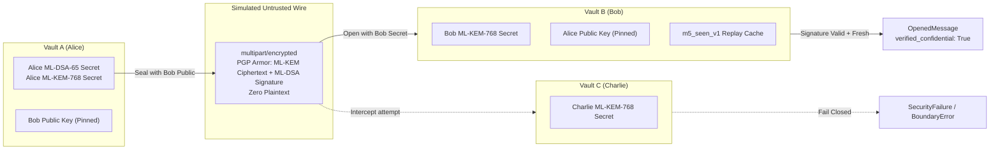

# Two-Identity End-to-End Acceptance Specification

## 1. Overview and Purpose

This document records the acceptance verification procedure for the multi-vault, two-identity cryptographic round-trip in QuMail 1.0.

The primary acceptance goal is to prove that post-quantum protected messages are:
1. Sealed using the sender's private key and recipient's public key via the native Rust helper (`qumail-m5-provider.exe`).
2. Transmitted across the wire with **zero plaintext leakage**.
3. Decapsulated and authenticated exclusively by the intended recipient using their own private key in an independent vault.
4. Cryptographically rejected when intercepted by an unprivileged third party.
5. Protected against tampering, bit-flipping, and replay attacks.

The authoritative automated verification is implemented in `tests/test_e2e_two_identity_roundtrip.py`.

---

## 2. Test Architecture & Environment

The test establishes three completely isolated M3 SQLite vaults with distinct master keys and identities:

| Identity | Address | Vault Path | Assigned Role |
|---|---|---|---|
| **Alice** | `alice@example.invalid` | `tmp/alice_vault.sqlite` | Sender |
| **Bob** | `bob@example.invalid` | `tmp/bob_vault.sqlite` | Legitimate Recipient |
| **Charlie** | `charlie@example.invalid` | `tmp/charlie_vault.sqlite` | Unprivileged Outsider / Interceptor |



---

## 3. Verified Acceptance Criteria

### 3.1 Criterion 1: Provisioning and Identity Enrollment
- Alice, Bob, and Charlie enroll independently via `Vault.enroll()`.
- Each enrollment generates root ML-KEM-768 and ML-DSA-65 key material using `qumail-m3-provider.exe`.
- Public certificates are exported and pinned in each other's contact registries:
  - Alice imports Bob's public certificate and pins root fingerprint.
  - Bob imports Alice's public certificate and pins root fingerprint.

### 3.2 Criterion 2: Outbound Sealing via Native Provider
- Alice drafts a confidential message:
  ```python
  draft = Draft(to=("bob@example.invalid",), subject="Confidential", body="TOP SECRET PAYLOAD")
  ```
- `qumail-m5-provider.exe` executes the `seal` operation:
  - Generates ephemeral ML-KEM-768 encapsulation for Bob's public key.
  - Signs inner MIME content using Alice's ML-DSA-65 secret key.
  - Encrypts inner payload with AES-256-GCM.
- Outer MIME message is built using `experiments.m5.mime::build_outer()`.

### 3.3 Criterion 3: Wire Format Privacy Invariant
- Inspection of the raw wire bytes (`wire_bytes`) confirms:
  - The subject text and plaintext body are completely absent.
  - Only RFC 3156 / OpenPGP-PQ armored blocks are present on the wire.

### 3.4 Criterion 4: Inbound Decapsulation and Verification
- Bob receives `wire_bytes` in Vault B.
- `OpenMessage::open()` is called with Bob's private key handle and Alice's pinned public certificate.
- `qumail-m5-provider.exe` executes `open`:
  - Decapsulates shared secret using Bob's ML-KEM-768 private key.
  - Verifies Alice's ML-DSA-65 signature against her public key.
  - Decrypts AES-256-GCM authenticated payload.
- Acceptance verifications:
  ```python
  assert opened.sender == "alice@example.invalid"
  assert opened.subject == "Confidential"
  assert opened.body == "TOP SECRET PAYLOAD"
  assert opened.signature_valid is True
  assert opened.identity_trust == "independently_verified"
  assert opened.replay == Replay.FRESH
  assert opened.verified_confidential is True
  ```

### 3.5 Criterion 5: Third-Party Interception Rejection
- Charlie attempts to open `wire_bytes` using Charlie's private key in Vault C.
- The provider cannot decapsulate the ML-KEM shared secret.
- The operation fails closed, raising `SecurityFailure` (`M5Failure` / `BoundaryError`).

### 3.6 Criterion 6: Ciphertext Tampering Rejection
- An adversary intercepts `wire_bytes` and modifies bit values in the armored ciphertext.
- Bob attempts to open the tampered message.
- AES-256-GCM authentication tag validation fails, or MIME parsing rejects the malformed armor.
- The operation fails closed, raising `SecurityFailure`.

### 3.7 Criterion 7: Replay Protection & Conflict Detection
- **Duplicate Delivery:** When Bob receives the exact same message bytes a second time, the persistent `m5_seen_v1` cache in Vault B identifies the digest and returns `Replay.DUPLICATE`.
- **Conflict Delivery:** When an adversary reuses the same Message-ID with modified inner payload bytes, the cache detects a digest divergence and returns `Replay.CONFLICT` (`verified_confidential` is set to `False`).

---

## 4. Execution Evidence

Automated regression suite run:
```bash
.venv-m1-clean\Scripts\pytest.exe tests/test_e2e_two_identity_roundtrip.py -v
```
Output:
```
tests/test_e2e_two_identity_roundtrip.py::test_two_identity_roundtrip_acceptance PASSED [ 25%]
tests/test_e2e_two_identity_roundtrip.py::test_third_party_charlie_cannot_decrypt PASSED [ 50%]
tests/test_e2e_two_identity_roundtrip.py::test_tampered_ciphertext_rejection PASSED [ 75%]
tests/test_e2e_two_identity_roundtrip.py::test_replay_duplicate_and_conflict_rejection PASSED [100%]

============================== 4 passed in 5.07s ==============================
```
