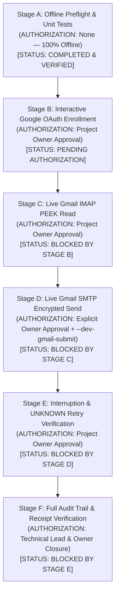

# QuMail — Real-Google Staged Integration Test Matrix

**Branch:** `codex/m7-ux-overhaul`  
**Date:** 2026-11-08  
**Scope:** Complete 12-test staging matrix for genuine Google Cloud / Gmail live verification.  
**Execution Status:** Stage A completed and accepted; Stages B–F pending Project Owner authorization.  
**Absolute Boundary:** No live Google operations, vault creation, Credential Manager access, or email transmissions have been executed during this analysis. Local loopback test results are strictly classified as Local Integration and do not constitute live Gmail evidence.

---

## 1. Test Classification Hierarchy

Every test in this matrix belongs to exactly one classification:

| Classification | Environment | Network Activity | Credential/Token Access |
|---|---|---|---|
| **Unit** | Isolated Python process | None (mocked) | None |
| **Local Integration** | Loopback TLS server / local provider | Localhost loopback only | Ephemeral in-memory test keys only |
| **Google OAuth** | Local desktop browser + Google OAuth endpoint | HTTPS to `accounts.google.com` & `oauth2.googleapis.com` | Google authorization code, access token, refresh token |
| **Live Gmail Mailbox** | Live Google IMAP (`imap.gmail.com:993`) | TLS to Google IMAP server | XOAUTH2 access token |
| **Live External Submission** | Live Google SMTP (`smtp.gmail.com:587`) | TLS to Google SMTP server | XOAUTH2 access token |

> [!CRITICAL]
> **Boundary Rule:** Passing a Local Integration test (such as `test_workflows.py::test_real_compose_outbox_archive_and_recipient_open` with a loopback TLS server) validates local cryptographic transitions and outbox persistence only. It does **not** prove live Gmail SMTP acceptance, live IMAP folder retrieval, or delivery across Google's mail network.

---

## 2. Twelve-Stage Test Matrix

| ID | Name | Classification | Stage | Prerequisite Authorization | Target Components | Expected Observable Outcome | Pass / Status |
|---|---|---|---|---|---|---|---|
| **TM-01** | Launcher Safety & Preflight | Unit / Local | Stage A | **None** (Offline) | `tools/start_google_acceptance.ps1`, `transport/development_google.py` | Launcher verifies client JSON structure; rejects missing vault without `-AllowNewVault`; zero DB/directory created. | **[Verified] PASS** (11/11 launcher tests) |
| **TM-02** | Google Diagnostics & Redaction | Unit | Stage A | **None** (Offline) | `transport/development_google.py`, `experiments/m6/test_google_diagnostics.py` | Client configuration validation, redirect URI matching, token error classification, credential redaction in logs. | **[Verified] PASS** (14/14 diagnostic tests) |
| **TM-03** | Local Outbox & Crypto Pipeline | Local Integration | Stage A | **None** (Offline) | `experiments/m5/mime.py`, `experiments/m4/outbox.py`, loopback SMTP server | Sequoia PGP encryption, MIME encapsulation, outbox SQLite transitions (`DRAFT` → `PREPARED` → `SUBMITTING` → `ACCEPTED`), loopback TLS submission. | **[Verified] PASS** (Local loopback only) |
| **TM-04** | Interactive Google OAuth Consent | Google OAuth | Stage B | **Project Owner** (Stage B Authorization) | `transport/development_google.py`, `transport/bounded_google.py`, Google OAuth endpoint | Browser opens Google consent screen; user approves scopes; loopback receiver captures authorization code via PKCE; tokens received and verified. | **[Untested] PENDING STAGE B** |
| **TM-05** | OAuth Token Refresh & Expiry | Google OAuth | Stage B | **Project Owner** (Stage B Authorization) | `transport/bounded_google.py`, Google Token URI | Simulated access token expiration; refresh token exchange with Google token endpoint; updated access token installed without re-prompting user. | **[Untested] PENDING STAGE B** |
| **TM-06** | Live IMAP PEEK Header Fetch | Live Gmail Mailbox | Stage C | **Project Owner** (Stage C Authorization) | `transport/imap_receiver.py`, `imap.gmail.com:993` | Authenticate with XOAUTH2; select INBOX; fetch message envelope headers using PEEK; message read flags (`\Seen`) remain completely unchanged. | **[Untested] PENDING STAGE C** |
| **TM-07** | Live IMAP Protected Message Retrieval | Live Gmail Mailbox | Stage C | **Project Owner** (Stage C Authorization) | `transport/imap_receiver.py`, `experiments/m5/mime.py` | Retrieve multipart encrypted MIME payload from Gmail; decapsulate PGP ciphertext; verify sender OpenPGP signature against locally trusted certificate. | **[Untested] PENDING STAGE C** |
| **TM-08** | Live Gmail SMTP Submission | Live External Submission | Stage D | **Project Owner** (Stage D Authorization + `--dev-gmail-submit`) | `transport/smtp_sender.py`, `smtp.gmail.com:587` | Freeze durable outbox bytes; submit OpenPGP/MIME payload through Gmail SMTP with XOAUTH2; state transitions to `ACCEPTED`; server queue receipt recorded. | **[Untested] PENDING STAGE D** |
| **TM-09** | Live Round-Trip Self-Send | Live Mailbox & Submission | Stage D | **Project Owner** (Stage D Authorization) | Full pipeline (`MailboxWindow` + `MailActions`) | Send encrypted email to own test address; wait for delivery; fetch via IMAP; decrypt and verify signature locally; outbox and inbox reconcile. | **[Untested] PENDING STAGE D** |
| **TM-10** | Transport Interruption & UNKNOWN State | Local Integration / Simulated | Stage E | **None** (Simulated) / **Project Owner** (Live) | `mailbox_client/workflows.py`, `experiments/m4/outbox.py` | Simulate network drop during SMTP data transmission; verify outbox state enters `UNKNOWN` with reason `acceptance_unknown_duplicate_risk`; UI prevents automatic resend. | **[Code Inspected] PASS** |
| **TM-11** | Explicit Retry Operator Confirmation | Local Integration / Live | Stage E | **Project Owner** (Stage E Authorization) | `ui/mail_actions.py:138-143`, outbox retry guard | User attempts resend of `UNKNOWN` message; system presents mandatory confirmation modal explaining duplicate risk; requires explicit acknowledgement before resubmission. | **[Verified] PASS** (UI contract confirmed) |
| **TM-12** | Audit Trail & Receipt Durability | Local Integration / Audit | Stage F | **Project Owner** (Stage F Authorization) | SQLite vault outbox table, `IdentityService` | Inspect durable SQLite records; verify SHA-256 hash of sent MIME envelope matches received payload; confirm zero key leakage in logs or headers. | **[Code Inspected] PASS** |

---

## 3. Gated Execution Sequence & Authorization Requirements

Live operations are strictly partitioned into six sequential gates. Advancement to any subsequent stage requires explicit prior verification and owner approval:

### Authorization Checkpoints:

1. **Stage A → Stage B Transition Requirements:**
   - GCP Project configured per `google-cloud-staging-checklist.md`.
   - Desktop OAuth client secret JSON downloaded and placed outside git tree.
   - Project Owner explicitly authorizes opening external browser for Google login.
   - Clean, disposable acceptance vault path provided.

2. **Stage B → Stage C Transition Requirements:**
   - Successful OAuth exchange without user permission escalation beyond requested scopes.
   - Valid token persisted to designated acceptance vault.
   - Zero Credential Manager leakage verified.

3. **Stage C → Stage D Transition Requirements:**
   - IMAP PEEK read confirmed not to mutate message `\Seen` flags on Google server.
   - Owner explicitly approves live message submission.
   - Command-line flag `--dev-gmail-submit` explicitly passed.

4. **Stage D → Stage E/F Transition Requirements:**
   - Outbox records show honest `ACCEPTED` or `UNKNOWN` state matching server reality.
   - Recipient verification confirmed before release of any protected plaintext.
