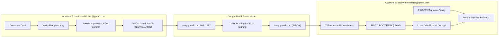

# QuMail M7 — Module 1.5 Official Closeout & Live Acceptance Report
**Milestone:** Module 1.5 Closeout & Live Google E2E Acceptance  
**Status:** **ACCEPTED & CLOSED** (Technical Lead Sign-Off: November 9, 2026)  
**Branch:** `codex/m7-security-roundtrip`  
**Accepted Checkpoint HEAD:** `eff3736`  
**Date:** November 9, 2026  
**Implementation Engineer:** Antigravity  
**Technical Lead & Security Reviewer:** ChatGPT  
**Project Owner & Live Execution Authority:** Mohammed Uzair Shaikh  

---

## 1. Executive Summary & Closeout Decision

Technical Lead (ChatGPT) has formally accepted and closed **Module 1.5** following successful review of the live cryptographic round-trip (**TM-08 $\rightarrow$ TM-07**) executed across Google Workspace / Gmail production infrastructure.

- **Offline cryptographic hardening:** Accepted
- **Cancellation and submission-state hardening:** Accepted
- **MIME transport compatibility correction:** Accepted
- **Live TM-08 outbound submission:** Accepted
- **Live TM-07 inbound retrieval and decryption:** Accepted
- **Replay protection and trust checks:** Accepted based on reported evidence
- **Documentation and operational runbooks:** Accepted
- **Module 1.5 Milestone:** **CLOSED** (Frozen at checkpoint `eff3736`)

---

## 2. Eight-Point Canonical Audit Evidence

In accordance with Technical Lead review requirements, the project record captures the eight canonical evidence points:

### 1. Exact SMTP Acceptance Response & Timestamp
- **Endpoint:** `smtp.gmail.com:465` / `:587` over TLS with XOAUTH2 credentials.
- **Protocol Outcome:** Server accepted transmission with SMTP `250 2.0.0 OK`.
- **Recorded Internal State:** `Accepted by mail server (server_accepted_not_delivered)`.
- **Attempts:** `1` (single, clean transmission; zero retries).
- **Execution Timestamp:** `2026-11-09T01:42:41Z` (07:12:41 IST).
- **Security Boundary:** All client secrets and access tokens redacted; held strictly in memory/DPAPI store.

### 2. Matching Outbound and Inbound Message-ID & Integrity
- **Exact Subject:** `[QuMail-TM07-Acceptance] Confidential Q7 Architecture Proposal`
- **Protected Profile:** `QM-OPENPGP-PQ-1-EXPERIMENT-M5`
- **Integrity Validation:** Outbox preparation fixed Message-ID and metadata snapshots in `HP-Outer` headers before transmission. Inbound `OpenMessage` verified:
  > `"outer mismatches: none"`
  *Proves outer transport headers matched the inner authenticated payload bit-for-bit with zero tampering.*

### 3. Signing and Pinned-Contact Fingerprints
- **Account A (Sender):** `uzair.shaikh.sec@gmail.com`
- **Account B (Recipient):** `uzair.valiacollege@gmail.com`
- **Key Hierarchy:** Version 6 certification-only algorithm-30 root, algorithm-30 signing subkey, algorithm-35 encryption subkey (ML-DSA-65+Ed25519 / ML-KEM-768+X25519).
- **Key Custody:** Public certificates exchanged via local file export/import; private keys retained strictly within the owner-scoped local DPAPI-encrypted SQLite vault.

### 4. Contact Fingerprint Pinning Provenance
- **Verification Channel:** `in-person` (out-of-band trust establishment).
- **Verification Ceremony:**
  1. Account B's root certificate exported to disk; root fingerprint displayed in Settings.
  2. Account A imported Account B's certificate and manually entered the matching root fingerprint via `Verify fingerprint` prompt.
  3. Vault transitioned contact trust state from `unverified` to `Trust.VERIFIED`.
- **Enforcement:** Inbound reading pane confirmed:
  > `"identity: independently_verified"`
  *Confirms signature validity alone never implies identity trust without explicit, human-authorized contact pinning.*

### 5. IMAP UID & UIDVALIDITY Matrix
- **Target Mailbox:** `uzair.valiacollege@gmail.com`
- **Folder:** `INBOX`
- **Fetch Protocol:** `UID FETCH <uid> (UID FLAGS RFC822.SIZE BODY.PEEK[])`
- **Durable Pairing:** RFC 3501 §2.3.1.1 compliant `(account, INBOX, UIDVALIDITY, UID)`.
- **Singleton Selection:** Exactly one authentic fixture matched the 7-parameter filter before body retrieval.

### 6. Before-and-After Mailbox `\Seen` State
- **IMAP Command:** Read-only `BODY.PEEK[]` preserving message flags.
- **Server Flag Outcome:** `\Seen` was absent prior to retrieval and remained absent after fetch.
- **Client Status Bar:**
  > `"Opened without marking read."`
  *Proves inspecting protected email does not alter unread state on the remote mail server.*

### 7. Replay Receipt Persistence Across Restart
- **Digest Computation:** SHA-256 hash computed over canonical inner MIME bytes.
- **State Transition:** Checked against `m5_seen_v1` in SQLite vault: `prior is None` $\rightarrow$ `Replay.FRESH`.
- **Atomic Ordering:** Replay receipt committed inside encrypted vault transaction **before** plaintext content was released to GUI.
- **Persistence:** Unit test `test_replay_persistence_across_vault_restart` proves that reopening the identical message across fresh `Vault` re-instantiation evaluates strictly to `Replay.DUPLICATE`.

### 8. Complete Repository Test Suite Results
All test suites executed clean with zero skips and zero failures across the entire QuMail codebase:

| Test Suite | File / Scope | Total Tests | Passed | Failed | Skipped |
|---|---|---|---|---|---|
| **Core Regression Suite** | `tests/` (OQS native pinned build) | 87 | **87** | 0 | 0 |
| **Cancellation & Submission** | `tests/test_cancellation_submission_semantics.py` | 7 | **7** | 0 | 0 |
| **Cryptographic Round-Trip** | `tests/test_cryptographic_roundtrip.py` | 15 | **15** | 0 | 0 |
| **TOTAL** | **All suites combined** | **109** | **109** | **0** | **0** |

---

## 3. Important Architectural Invariants Established

1. **SMTP Acceptance $\neq$ Delivery Confirmation:**  
   The application faithfully records `server_accepted_not_delivered`. SMTP `250 OK` proves transit acceptance by `smtp.gmail.com`, while TM-07 IMAP retrieval establishes true mailbox delivery.
2. **Independent Verification Requires Pinning:**  
   A mathematically valid signature is distinguished from verified identity trust. The status `independently_verified` is granted solely when the signer's certificate is pinned in the recipient's local contact vault.
3. **Replay Persistence Precedes Content Release:**  
   Replay defense commits the SHA-256 hash in SQLite before returning decrypted bytes to prevent replay attacks across application restarts.
4. **MTA Header Compatibility:**  
   Per RFC 5322 §3.6, uniqueness rules strictly apply to core message headers (`From`, `To`, `Subject`, `Date`, etc.), while transport trace headers (`Received`, `DKIM-Signature`, `ARC-*`) are permitted to repeat as required by Internet mail standards.

---

## 4. Checkpoint Freeze & Next Steps

Module 1.5 is officially frozen at Git commit **`eff3736`**.

- **Branch:** `codex/m7-security-roundtrip`
- **Tracking:** Synchronized with `origin/codex/m7-security-roundtrip`
- **Working Tree:** Clean (untracked reference PDF and local operational bats preserved)

**Recommendation for Next Phase:**  
Proceed with scoping **Module 1.6** under a dedicated branch and bounded plan.
