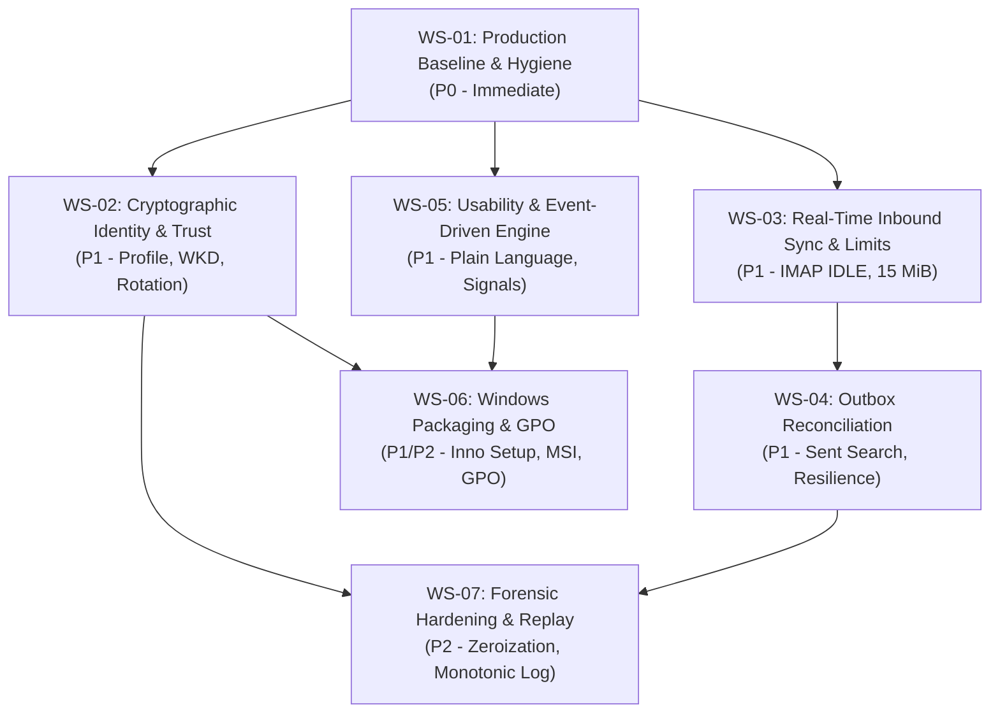

# QuMail M7 — Module 1.6 Engineering Roadmap
## Substantial Implementation Workstreams for Corporate Production Readiness

**Milestone:** M7 — Module 1.6  
**Document:** Engineering Implementation Roadmap  
**Author:** Antigravity (Implementation Engineer)  
**Reviewer:** ChatGPT (Technical Lead & Security Architect)  
**Project Owner:** Mohammed Uzair Shaikh  
**Date:** 2026-11-09  
**Branch:** `codex/m7-module-1-6-planning`  
**Accepted Baseline Checkpoint:** `eff3736` | **Closeout Anchor:** `c9a3cf4`  

---

## 1. Roadmap Architecture and Sequencing

The Module 1.6 engineering roadmap transitions QuMail from an accepted two-account cryptographic prototype to a robust, pilot-ready corporate email client. 

Rather than dozens of disjointed patches, work is organized into **seven substantial, interdependent workstreams** executed across three progressive deployment gates:

```
┌─────────────────────────────────────────────────────────────────────────────┐
│                       GATE 0: PRE-PILOT FOUNDATION                          │
│  WS-01: Production Baseline & Native Engine Hygiene                         │
└──────────────────────────────────────┬──────────────────────────────────────┘
                                       │
        ┌──────────────────────────────┴──────────────────────────────┐
        ▼                                                             ▼
┌──────────────────────────────────────────────┐ ┌──────────────────────────────────────────────┐
│        GATE 1: PILOT READINESS (CORE)        │ │        GATE 1: PILOT READINESS (CORE)        │
│  WS-02: Identity, Profile & Key Lifecycle    │ │  WS-03: Inbound Mailbox Sync & 15 MiB Limits│
└──────────────────────┬───────────────────────┘ └──────────────────────┬───────────────────────┘
                       │                                                │
                       └──────────────────────┬─────────────────────────┘
                                              ▼
┌─────────────────────────────────────────────────────────────────────────────┐
│                       GATE 1: PILOT READINESS (CORE)                        │
│  WS-04: Automated Outbox Reconciliation & Delivery Resilience               │
│  WS-05: Corporate Usability, Non-Technical UX & Event-Driven Engine         │
└──────────────────────────────────────┬──────────────────────────────────────┘
                                       │
        ┌──────────────────────────────┴──────────────────────────────┐
        ▼                                                             ▼
┌──────────────────────────────────────────────┐ ┌──────────────────────────────────────────────┐
│     GATE 2: ENTERPRISE FLEET OPERATIONS      │ │     GATE 2: ENTERPRISE FLEET OPERATIONS      │
│  WS-06: Windows Packaging & GPO Deployment   │ │  WS-07: Forensic Hardening & Replay Armor    │
└──────────────────────────────────────────────┘ └──────────────────────────────────────────────┘
```

---

## 2. Detailed Workstream Specifications

### WS-01: Production Baseline & Native Engine Hygiene
* **Identifier:** `WS-01`
* **Target Gate:** Gate 0 (Immediate Pre-Pilot Gate)
* **Objective:** Eliminate all developer-environment artifacts, invert application entry points, compile hardened native release binaries, and scrub diagnostic console output.
* **Problems Addressed:** `M16-ONB-002`, `M16-OPS-001`, `M16-SEC-001`, `M16-INB-004`.
* **Components Affected:** `main.py`, `ui/mailbox_window.py`, `mailbox_client/service.py`, `experiments/m5/mime.py`, `experiments/m2/Cargo.toml`.
* **Dependencies:** None (starting foundation).
* **Architectural Changes:**
  - Modern mailbox client becomes the default path in `main.py`. The legacy simulator is relegated to an explicit `--dev-legacy-simulator` flag.
  - Native binary lookup dynamically resolves against application install directory (`bin/qumail-m5-provider.exe`) via `sys._MEIPASS` or executable relative path, replacing hardcoded `tmp/` references.
  - Rust provider compiled via `cargo build --release` with MSVC hardening flags (`/DYNAMICBASE`, `/NXCOMPAT`, `/GUARD:CF`).
  - Diagnostic `print()` statements and `traceback.print_exc()` calls in `service.py`, `mime.py`, and `mailbox_window.py` replaced by standard Python `logging`.
* **Implementation Scope:** ~250 lines changed across 5 files + Cargo build scripts.
* **Security Considerations:** Eliminates accidental user exposure to the unauthenticated legacy KME simulator. Guarantees ASLR/DEP binary hardening for the native cryptographic process.
* **Testing Strategy:**
  - Automated CLI test verifying default `python main.py` opens modern UI.
  - Static grep CI check ensuring zero `print()` in production packages.
  - Binary inspection via `dumpbin /headers` validating security flags.
* **Acceptance Criteria:**
  - `python main.py` launches `MailboxWindow` with clean terminal output.
  - Application functions on a clean machine lacking any `tmp/` directory.
* **Estimated Complexity:** Low (1–2 engineering days).
* **Risks:** None; low regression potential.
* **Database / Format Migration:** None.

---

### WS-02: Cryptographic Identity, Profile & Enterprise Trust
* **Identifier:** `WS-02`
* **Target Gate:** Gate 1 (Pilot Readiness)
* **Objective:** Standardize the post-quantum wire profile, implement automated contact discovery via Web Key Directory (WKD), enforce subkey expiration tracking, and support time-aware historical verification.
* **Problems Addressed:** `M16-KEY-001`, `M16-ONB-001`, `M16-KEY-002`, `M16-KEY-004`.
* **Components Affected:** `experiments/m5/model.py`, `experiments/m5/mime.py`, `experiments/m5/services.py`, `core/identity_service.py`, `experiments/m3/vault.py`, `ui/identity_settings.py`.
* **Dependencies:** `WS-01`.
* **Architectural Changes:**
  - Wire profile transition: Emits standardized `QM-OPENPGP-PQ-v1` marker while maintaining backward-compatible decryption for incoming messages marked `QM-OPENPGP-PQ-1-EXPERIMENT-M5`.
  - WKD Client: Implements RFC-compliant Web Key Directory HTTPS client (`https://openpgpkey.domain/.well-known/openpgpkey/hu/...`) with SHA-1 Z-base32 hash encoding for automated public-key lookup.
  - Subkey Expiration Monitor: Background check compares subkey expiration against current clock; emits `SubkeyExpiringSoon` warning 30 days prior.
  - Historical Signer Verifier: Validates composite signatures against the signer key validity status at the timestamp in the signed `Date` header.
* **Implementation Scope:** ~550 lines of new code across 6 files.
* **Security Considerations:** WKD lookups require strict TLS certificate verification and direct matching of retrieved User ID to the recipient email address. Prevents key substitution attacks from untrusted key servers.
* **Testing Strategy:**
  - Unit tests with mock WKD server returning valid/invalid public certificates.
  - Wire compatibility tests between `QM-OPENPGP-PQ-v1` and experimental `M5`.
  - Signature verification test against expired certificates with historical timestamps.
* **Acceptance Criteria:**
  - Composing to a corporate coworker on a WKD-enabled domain automatically resolves and pins their public key without manual fingerprint copy-pasting.
  - Existing Module 1.5 acceptance messages decrypt with full verified fidelity.
* **Estimated Complexity:** Medium (3–4 engineering days).
* **Risks:** Domain WKD servers may be absent in small enterprises; requires graceful fallback to manual import.
* **Database / Format Migration:** Vault account schema retains backwards compatibility; adds optional `wkd_synced: bool` field to contact entries.

---

### WS-03: Real-Time Inbound Mailbox Sync & Expanded Capacity
* **Identifier:** `WS-03`
* **Target Gate:** Gate 1 (Pilot Readiness)
* **Objective:** Deliver everyday email client reliability with background IMAP IDLE synchronization, desktop notifications, and real-world message capacity (15 MiB wire, 10 MiB attachments) via streaming buffers.
* **Problems Addressed:** `M16-INB-001`, `M16-INB-002`, `M16-INB-003`.
* **Components Affected:** `mailbox_client/gmail.py`, `mailbox_client/service.py`, `experiments/m5/model.py`, `experiments/m5/mime.py`, `experiments/m5/provider.py`, `ui/mailbox_window.py`.
* **Dependencies:** `WS-01`.
* **Architectural Changes:**
  - `MailboxSyncWorker`: Dedicated background thread maintaining an authenticated TLS connection to `imap.gmail.com:993`. Uses IMAP `IDLE` (RFC 2177) with a 2-minute keep-alive ping and automatic reconnection logic.
  - Desktop Toast Notifications: Dispatches native Windows notifications on new incoming secure emails.
  - Increased Capacity Budgets:
    - `MAX_WIRE`: 256 KiB → 15 MiB.
    - `MAX_BODY`: 8 KiB → 1 MiB.
    - `MAX_ATTACHMENT_BYTES`: 16 KiB → 10 MiB (total up to 10 files).
  - Streamed Provider IPC: The native provider pipe IPC is upgraded to handle streaming byte chunks with backpressure, avoiding whole-payload memory spikes during large attachment encryption.
  - SQLite Header Index: Replaces 30-message in-memory page with an append-only `inbox_headers` SQLite table with full-text search (FTS5).
* **Implementation Scope:** ~800 lines across 6 files + provider Rust IPC refactor.
* **Security Considerations:** Streaming decryption must buffer and verify the final OpenPGP SEIPDv2 authentication tag BEFORE writing decrypted attachment bytes to user-visible files, maintaining the "verify then release" invariant.
* **Testing Strategy:**
  - Connection interruption / reconnection test simulating Wi-Fi toggles during IMAP IDLE.
  - E2E cryptographic round trip with an 8 MiB PDF attachment.
  - Memory profiling under 15 MiB payload processing to prove bounded RAM usage (<128 MiB peak).
* **Acceptance Criteria:**
  - New incoming email appears in the inbox automatically within 15 seconds without user clicking Refresh.
  - Users can send and receive a 10 MiB attachment securely.
* **Estimated Complexity:** High (5–6 engineering days).
* **Risks:** Native provider IPC changes could destabilize the existing verified M5 provider if not carefully isolated.
* **Database / Format Migration:** Adds `inbox_headers` table to SQLite vault database; auto-created on startup.

---

### WS-04: Automated Outbox Reconciliation & Delivery Resilience
* **Identifier:** `WS-04`
* **Target Gate:** Gate 1 (Pilot Readiness)
* **Objective:** Eliminate manual Gmail web checks for `UNKNOWN` delivery states, automate IMAP Sent-folder reconciliation, provide exponential backoff for transient network errors, and expand queue capacity.
* **Problems Addressed:** `M16-OUT-001`, `M16-OUT-002`, `M16-OUT-003`.
* **Components Affected:** `experiments/m4/model.py`, `experiments/m4/services.py`, `mailbox_client/workflows.py`, `ui/mail_actions.py`.
* **Dependencies:** `WS-01`, `WS-03`.
* **Architectural Changes:**
  - Automated Reconciliation Worker: On boot or network restoration, checks all `UNKNOWN` operations by issuing an IMAP search for the stable `Message-ID` in `[Gmail]/Sent Mail`.
    - If message found in Sent Mail: Transitions `UNKNOWN` → `ACCEPTED` with automated audit receipt.
    - If definitively absent after confirmation window: Prompts user with safe one-click retry.
  - Transient Retry Scheduler: Network failures occurring *before* the SMTP `DATA` phase (e.g. DNS timeout, connection refused) are automatically retried up to 3 times with exponential backoff (2s, 8s, 30s) without entering `UNKNOWN` or requiring user clicks.
  - Outbox Capacity Expansion: Increases `MAX_OPERATIONS` from 16 to 256; implements automated FIFO archiving of `ACCEPTED` receipts older than 30 days.
* **Implementation Scope:** ~450 lines across 4 files.
* **Security Considerations:** Automatic retry is strictly forbidden once the `DATA` command is in flight. Only pre-DATA transport drops may be automatically retried; post-DATA drops remain `UNKNOWN` until verified via IMAP Sent search.
* **Testing Strategy:**
  - Mock SMTP server simulating connection dropped after `DATA` command.
  - Automated reconciliation test verifying successful detection of `Message-ID` in simulated Sent folder.
  - Queue stress test with 50 concurrent outbound messages.
* **Acceptance Criteria:**
  - Interrupted send automatically resolves to `Accepted by mail server` upon network reconnection without user logging into Gmail Web.
* **Estimated Complexity:** Medium (3–4 engineering days).
* **Risks:** Gmail IMAP folder localized names (e.g. `[Gmail]/Sent Mail` vs localized folder names); must use IMAP `\Sent` attribute discovery (RFC 6154).
* **Database / Format Migration:** None; uses existing `m4_outbox_v1` subrecord schema.

---

### WS-05: Corporate Usability, Non-Technical UX & Event-Driven Engine
* **Identifier:** `WS-05`
* **Target Gate:** Gate 1 (Pilot Readiness)
* **Objective:** Eliminate technical cryptographic jargon from the UI, replace CPU-draining 50 ms polling timers with event-driven Qt signals, and provide a secure, sandboxed Markdown viewer.
* **Problems Addressed:** `M16-UX-001`, `M16-UX-002`, `M16-UX-003`.
* **Components Affected:** `ui/mailbox_window.py`, `ui/mail_actions.py`, `ui/mail_accessibility.py`, `ui/design_system.py`.
* **Dependencies:** `WS-01`.
* **Architectural Changes:**
  - Comprehensive Plain-Language String Audit:
    - Replaces `Accepted by mail server (server_accepted_not_delivered)` with `Sent to mail server · In transit`.
    - Replaces `Signature valid; identity: independently_verified; replay: fresh` with `Verified from Coworker · Encrypted & Signed`.
    - Replaces internal error codes (`Failure: Code.LIMIT`, `Error.POLICY`) with clear guidance (`Attachment exceeds 10 MiB limit`, `Recipient public key is unverified`).
  - Event-Driven Worker Engine: Replaces `QTimer(self).start(50)` polling loops with custom Qt worker signals:
    ```python
    class WorkerSignals(QObject):
        finished = pyqtSignal(object)
        error = pyqtSignal(Exception)
    ```
    Workers emit signals to the GUI thread; eliminating idle timer CPU wakeups.
  - Secure Markdown Renderer: Converts decrypted plain-text into clean Qt RichText formatting (headings, lists, bold, code blocks), strictly stripping HTML tags (`<script>`, `<iframe>`, ``) and preventing remote resource loading.
* **Implementation Scope:** ~500 lines across 4 files.
* **Security Considerations:** Markdown rendering must never instantiate WebEngine or execute JavaScript. Remote images must remain completely disabled to prevent tracking pixels.
* **Testing Strategy:**
  - CPU profiling during 5 minutes of idle state (<0.1% CPU target).
  - Usability walkthrough test validating all UI strings.
  - XSS fuzzing vectors passed into Markdown renderer to verify HTML sanitization.
* **Acceptance Criteria:**
  - Zero technical protocol codes visible in normal user workflows.
  - CPU usage drops to 0.0% when idle.
* **Estimated Complexity:** Medium (3 engineering days).
* **Risks:** Low; primarily frontend improvements.
* **Database / Format Migration:** None.

---

### WS-06: Windows Packaging, Enterprise GPO & Deployment
* **Identifier:** `WS-06`
* **Target Gate:** Gate 2 (Enterprise Fleet Operations)
* **Objective:** Produce a signed Windows installer (MSI / Inno Setup), support enterprise Group Policy / Registry configuration, and provide a secure employee offboarding / deprovisioning command.
* **Problems Addressed:** `M16-OPS-002`, `M16-ONB-003`, `M16-ONB-004`.
* **Components Affected:** `main.py`, `tools/package_windows.py`, `installer/qumail.iss`, `core/enterprise_config.py`.
* **Dependencies:** `WS-01`, `WS-05`.
* **Architectural Changes:**
  - PyInstaller / cx_Freeze build pipeline: Packages Python runtime, PyQt6, cryptography, and native Rust binaries into a self-contained distribution directory (`dist/QuMail/`).
  - Inno Setup installer script generating `QuMailSetup.exe` with silent install flags (`/VERYSILENT`, `/ALLUSERS`).
  - Enterprise Policy Loader: Automatically reads enterprise settings on startup from `HKLM\Software\Policies\QuMail` or `%PROGRAMDATA%\QuMail\enterprise_config.json`:
    - `GoogleOAuthClientId`
    - `DefaultVaultPath`
    - `AllowedDomains`
    - `EnforcePQCrypto: true`
  - Deprovisioning CLI: `qumail.exe --deprovision --account <email>` securely zeroizes the local SQLite vault account blob, calls `CredDeleteW` on the Windows Credential Store master key, and exits.
* **Implementation Scope:** ~600 lines of packaging and config loader scripts.
* **Security Considerations:** Installer binaries and native executables must be signed with the organization's Authenticode code-signing certificate to prevent Windows Defender SmartScreen warnings.
* **Testing Strategy:**
  - Clean VM deployment test: Install via MSI/Inno Setup on fresh Windows 11 machine without Python or Rust installed.
  - GPO registry configuration injection test.
  - Deprovisioning test verifying complete unrecoverability of local keys.
* **Acceptance Criteria:**
  - System installs cleanly to `C:\Program Files\QuMail`, launches from Start Menu, and loads corporate Google OAuth credentials automatically from GPO.
* **Estimated Complexity:** High (4–5 engineering days).
* **Risks:** Code-signing certificate acquisition and Windows SmartScreen reputation buildup.
* **Database / Format Migration:** None.

---

### WS-07: Security Hardening & Forensic Resilience
* **Identifier:** `WS-07`
* **Target Gate:** Gate 2 (Enterprise Fleet Operations)
* **Objective:** Implement in-memory sensitive buffer zeroization, out-of-vault monotonic replay receipts, and strict RFC 5322 header injection sanitization.
* **Problems Addressed:** `M16-SEC-002`, `M16-SEC-003`, `M16-SEC-004`.
* **Components Affected:** `experiments/m5/mime.py`, `experiments/m5/services.py`, `experiments/m3/vault.py`, `experiments/m3/secure_store.py`.
* **Dependencies:** `WS-01`, `WS-02`.
* **Architectural Changes:**
  - Memory Zeroization: Implements native zeroization helpers (`secure_zero()`) for private key buffers and decrypted plaintext bytearrays immediately upon window hide or lock.
  - Out-of-Vault Replay Log: Stores SHA-256 replay digests in Windows Credential Manager or an append-only registry key (`HKCU\Software\QuMail\ReplayLog`), ensuring that restoring an old database backup cannot resurrect an epoch window for replay attacks.
  - Header Injection Defense: Validates all inner headers with strict regex matching, rejecting CR (`\r`), LF (`\n`), null bytes, or non-printable control characters in `Subject`, `From`, `To`, and `Message-ID`.
* **Implementation Scope:** ~350 lines across 4 files.
* **Security Considerations:** Defends against same-user local forensic extraction and malicious message craft attacks.
* **Testing Strategy:**
  - Forensic memory dump analysis verifying zero residual plaintext after viewer close.
  - Replay attack simulation after full database restore from an older backup.
  - Fuzzing suite with CRLF header injection payloads.
* **Acceptance Criteria:**
  - Database rollback fails to re-play an already observed message.
  - Header injection attempts are rejected with `Failure(Code.INVALID)`.
* **Estimated Complexity:** Medium (3–4 engineering days).
* **Risks:** Windows Credential Manager size limits (must store Bloom filter or root Merkle hash of replay receipts rather than unbound raw hashes).
* **Database / Format Migration:** None.

---

## 3. Workstream Dependency and Execution Sequence



---

## 4. Resource Allocation and Complexity Estimates

| Workstream | Identifier | Priority | Target Gate | Estimated Complexity | Engineering Days | Primary Files |
|---|---|---|---|---|---|---|
| **Production Baseline & Hygiene** | WS-01 | P0 | Gate 0 | Low | 1–2 days | `main.py`, `service.py`, `Cargo.toml` |
| **Identity, Profile & Trust** | WS-02 | P1 | Gate 1 | Medium | 3–4 days | `model.py`, `mime.py`, `identity_service.py` |
| **Inbound Sync & 15 MiB Limits** | WS-03 | P1 | Gate 1 | High | 5–6 days | `gmail.py`, `provider.py`, `mailbox_window.py` |
| **Outbox Reconciliation & Resilience**| WS-04 | P1 | Gate 1 | Medium | 3–4 days | `model.py`, `workflows.py`, `mail_actions.py` |
| **Usability & Event-Driven UX** | WS-05 | P1 | Gate 1 | Medium | 3 days | `mailbox_window.py`, `mail_accessibility.py` |
| **Windows Packaging & GPO** | WS-06 | P1/P2 | Gate 2 | High | 4–5 days | `package_windows.py`, `enterprise_config.py` |
| **Forensic Hardening & Replay** | WS-07 | P2 | Gate 2 | Medium | 3–4 days | `vault.py`, `services.py`, `mime.py` |
| **Total Roadmap Scope** | — | — | — | — | **22–28 days** | ~3,500 lines of code & tests |
