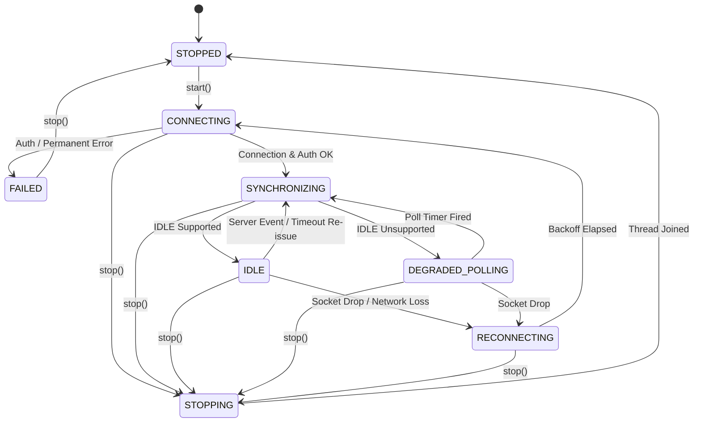

# QuMail Mailbox Synchronization and Cursor Model

**Milestone:** M7 — Module 1.6  
**Workstream:** WS-03 — Event-Driven Mailbox Synchronization, Background Inbox & Attachment Pipeline  
**Document:** Technical Specification & Operations Guide  
**Status:** Approved for Implementation & Pilot Testing  

---

## 1. Overview and Architecture

Prior to Module 1.6 WS-03, QuMail functioned as a static, manual-refresh email reader: incoming messages were only retrieved when the user clicked "Refresh headers", message caching was limited to the latest 30 headers, and no background synchronization or push change detection existed.

WS-03 introduces a reliable, event-driven background mailbox synchronization engine designed to provide everyday corporate email reliability while preserving QuMail's strict zero-compromise cryptographic trust boundaries.

### 1.1 Architectural Principles
1. **Decoupled Asynchronous Execution:** Network operations, IMAP protocol parsing, and MIME decoding run entirely in background worker threads, never blocking the Qt GUI thread.
2. **Event-Driven Push via IMAP IDLE:** Implements RFC 2177 `IDLE` to receive immediate push notifications when new emails arrive or flags change on the mail server.
3. **Safe Fallback Polling:** When a server lacks `IDLE` capability or when network degradation interrupts IDLE, the engine seamlessly transitions to bounded, jittered periodic polling without spinning in aggressive network loops.
4. **Persistent, Race-Safe Cursors:** Synchronization state is anchored in a per-mailbox `MailboxCursor` that tracks authoritative `UIDVALIDITY`, `UIDNEXT`, and synchronized UIDs, persisted transactionally within the encrypted SQLite vault.
5. **Metadata-First Encrypted Index:** By default, background synchronization retrieves only message headers and metadata via non-mutating `BODY.PEEK[]` commands. Complete message bodies and attachments are retrieved on-demand only when explicitly opened by the user.
6. **Non-Mutating Read State Invariant:** Background synchronization and background retrieval **never mutate `\Seen` flags** on the mail server. Only explicit user actions in the interface trigger read-state updates.
7. **Authoritative Unread Accounting:** Unread counts are computed directly from authoritative mailbox flags and reconciled upon reconnect, preventing counter drift or double-counting.

---

## 2. Worker Lifecycle and State Machine

The synchronization engine (`core/mailbox_sync.py:MailboxSyncEngine`) implements an explicit finite state machine:



### 2.1 State Definitions

| State | Identifier | Description | Invariants |
|---|---|---|---|
| **Stopped** | `STOPPED` | Worker thread is not executing; socket is closed. | Zero CPU or network utilization. |
| **Connecting** | `CONNECTING` | Establishing TCP + TLS connection and authenticating via XOAUTH2 or credentials. | Bounded setup timeout (8s). Clamped to operation budget. |
| **Synchronizing** | `SYNCHRONIZING` | Active synchronization pass: checking UIDVALIDITY, querying UIDs, fetching headers, reconciling expunges. | Vault transaction held only during database read/write; never held during network I/O. |
| **Idle** | `IDLE` | Connection is in RFC 2177 IDLE state waiting for unsolicited untagged server notifications (`* N EXISTS`, `* N EXPUNGE`). | Periodic re-issue timer active (default 10 minutes) to avoid server-side timeouts. |
| **Reconnecting** | `RECONNECTING` | Transient connection error encountered; waiting out exponential backoff with jitter before retrying. | Bounded backoff: initial 1.0s, multiplier 2.0x, maximum 60.0s, +/- 20% jitter. |
| **Degraded Polling** | `DEGRADED_POLLING` | Operating in periodic fallback polling mode because the server lacks `IDLE` capability or IDLE repeatedly failed. | Configurable poll interval (default 60s, clamped between 10s and 600s). No aggressive spin loops. |
| **Stopping** | `STOPPING` | Shutdown or cancellation requested; interrupting socket waits and waiting for thread join. | Bounded join timeout (5s); forces socket close if uncooperative. |
| **Failed** | `FAILED` | Permanent, non-recoverable error encountered (e.g. invalid credentials or expired OAuth consent). | Emits `auth_required` event and ceases automatic reconnection attempts until user intervenes. |

---

## 3. IMAP IDLE Protocol & Reconnection Mechanics

### 3.1 IDLE Command Lifecycle (RFC 2177)
1. **Entry:** After selecting the mailbox in read-only mode (`EXAMINE "INBOX"`), the client generates a unique command tag and issues `TAG IDLE\r\n`.
2. **Continuation:** The server returns `+\r\n` or `+ idling\r\n`. The client records `is_idling = True`.
3. **Event Listening:** The client monitors the underlying socket via non-blocking `select.select()` with small timeout slices (1.0s) checking for cancellation.
4. **Server Notification:** When an unsolicited server event arrives (e.g. `* 15 EXISTS\r\n` or `* 3 EXPUNGE\r\n`), the client:
   - Immediately transmits `DONE\r\n`.
   - Reads until the tagged response `TAG OK IDLE completed\r\n` is received.
   - Transitions to `SYNCHRONIZING` to retrieve the new message headers and update the local index.
   - Re-enters `IDLE`.
5. **Periodic Re-Issue:** RFC 2177 §3 recommends re-issuing IDLE at least every 29 minutes to prevent server-side NAT and firewall state drop. QuMail enforces a conservative 10-minute re-issue window (`idle_timeout_seconds = 600.0`), issuing `DONE\r\n`, executing a fast synchronization check, and re-entering IDLE.

### 3.2 Bounded Exponential Backoff and Jitter
When an active connection drops or encounters a transient network timeout:
$$\text{delay} = \min(\text{backoff\_max}, \text{backoff} \times \text{random}(0.8, 1.2))$$
$$\text{backoff}_{\text{next}} = \min(\text{backoff\_max}, \text{backoff} \times \text{backoff\_multiplier})$$
- Default settings: $\text{initial} = 1.0\text{s}$, $\text{multiplier} = 2.0$, $\text{max} = 60.0\text{s}$.
- Prevents thunder-herd reconnection spikes against corporate mail servers following Wi-Fi or VPN reconnection.

---

## 4. Mailbox Cursor & Race-Safe Synchronization

The synchronization cursor (`core/mailbox_cursor.py:MailboxCursor`) manages mailbox generation and message UID progression:

```python
@dataclass
class MailboxCursor:
    account_id: str
    mailbox: str = "INBOX"
    uidvalidity: int = 0
    uidnext: int = 1
    highest_modseq: int | None = None
    last_sync_uid: int = 0
    synced_uids: set[int] = field(default_factory=set)
    last_sync_time: float = 0.0
```

### 4.1 UIDVALIDITY Invariants & Rollover Recovery
1. **Definition:** Per RFC 3501 §2.3.1.1, message UIDs are strictly unique only within a single mailbox generation identified by `UIDVALIDITY`. If a mailbox is deleted, re-created, or restored from an older backup on the server, `UIDVALIDITY` changes.
2. **Rollover Detection:** On every connection, `EXAMINE "INBOX"` returns the current `[UIDVALIDITY <val>]`. The cursor evaluates:
   ```python
   if cursor.uidvalidity != server_uidvalidity:
       # Invalidate all cached UIDs immediately!
       cursor.reset(server_uidvalidity)
       index.clear()
   ```
3. **Safety Guarantee:** QuMail **never** reuses old UID records across a UIDVALIDITY change. All local cached headers are purged and a full safe resynchronization is executed.

### 4.2 Expunge and Vanished Reconciliation
Messages deleted or moved out of the inbox on another device or web client must be reflected locally:
1. `server_uids = client.search_all_uids()`
2. `expunged = cursor.reconcile_expunges(server_uids)`
3. For each `uid` in `expunged`:
   - `index.remove_message(uid)`
   - Emits `on_messages_removed(account_id, mailbox, expunged)`
   - Reconciles unread count.

### 4.3 Race Conditions Handled
- **Message arriving during sync:** The server UIDs returned by `UID SEARCH ALL` represent a point-in-time snapshot. Any message arriving between search and fetch will be announced via the subsequent IDLE `EXISTS` event and synchronized in the next pass.
- **Connection drop during sync:** If the network fails while headers are being fetched, the vault transaction is **rolled back**. The cursor does not advance; on reconnect, the sync resumes idempotently from the last committed state.
- **Duplicate sync triggers:** A threading lock (`self._lock`) and single-worker invariant prevent concurrent sync passes from executing simultaneously for the same account.

---

## 5. Metadata-First Encrypted Mailbox Index

The local mailbox index (`core/mailbox_index.py:MailboxIndex`) stores message records in the encrypted vault (`m7_mailbox_index_v1`).

### 5.1 Indexed Fields
```python
@dataclass
class IndexedMessage:
    uid: int
    uidvalidity: int
    mailbox: str
    account_id: str
    sender_display: str
    sender_address: str
    recipients: tuple[str, ...] = ()
    subject: str = ""
    date: str = ""
    date_ts: float = 0.0
    message_id: str = ""
    size: int = 0
    flags: tuple[str, ...] = ()
    seen: bool = False
    has_attachments: bool = False
    attachments_meta: tuple[dict[str, Any], ...] = ()
    snippet: str = ""
    in_reply_to: str = ""
    references: tuple[str, ...] = ()
    raw_digest: str | None = None
```

### 5.2 Storage & Migration Invariants
- **Zero Plaintext Database:** Message metadata is encrypted at rest using AES-256-GCM via the account's master key in the SQLite `accounts` table.
- **Dual-Record Persistence:** To ensure 100% backward compatibility with legacy M6 components, every index write updates both `m7_mailbox_index_v1` (unbounded metadata index) and `m6_mailbox_v1` (the 30-message header window).
- **No Credentials in Index:** Index records strictly contain message metadata; OAuth access tokens, refresh tokens, and private keys are never stored in index records.

---

## 6. On-Demand Body Fetch & Read-State Invariant

1. **Background Sync:** Uses `BODY.PEEK[HEADER.FIELDS (FROM TO CC SUBJECT DATE MESSAGE-ID CONTENT-TYPE)]`. The `BODY.PEEK` command instructs the IMAP server not to set the `\Seen` flag.
2. **On-Demand Body Fetch:** When the user selects a message in the interface, `fetch_message_body` executes `UID FETCH <uid> (BODY.PEEK[])`. This retrieves the complete raw MIME message for verification and decryption without modifying server flags.
3. **Explicit Read State:** The `\Seen` flag is only altered when the user explicitly triggers a read-state action or when the UI policy explicitly marks the message read via `MailboxService.set_seen()`.

---

## 7. Application-Level Interface for WS-05 (Three-Pane UI)

`MailboxService` provides clean, high-level methods decoupled from IMAP protocol details:

```python
# List metadata-first indexed messages with pagination, unread filter, and search query
messages = service.get_indexed_messages(lease, budget, limit=50, before_uid=None, unread_only=False, query="invoice")

# Authoritative unread and total counts
unread, total = service.get_unread_counts(lease, budget, mailbox="INBOX")

# On-demand raw message retrieval (using BODY.PEEK[])
raw_bytes, seen = service.fetch_message_body(lease, message_key, budget)

# Explicit attachment export with atomic no-clobber write
exported_path = service.export_attachment(lease, message_key, attachment_index, destination_path, budget)
```

The synchronization engine emits structured events:
- `on_sync_started(account_id, mailbox)`
- `on_sync_completed(account_id, mailbox, stats)`
- `on_new_messages(account_id, mailbox, list[IndexedMessage])`
- `on_messages_changed(account_id, mailbox, list[IndexedMessage])`
- `on_messages_removed(account_id, mailbox, list[int])`
- `on_unread_count_changed(account_id, mailbox, unread_count, total_count)`
- `on_state_changed(account_id, old_state, new_state, detail)`
- `on_auth_required(account_id, error_message)`
- `on_sync_error(account_id, error, is_permanent)`
