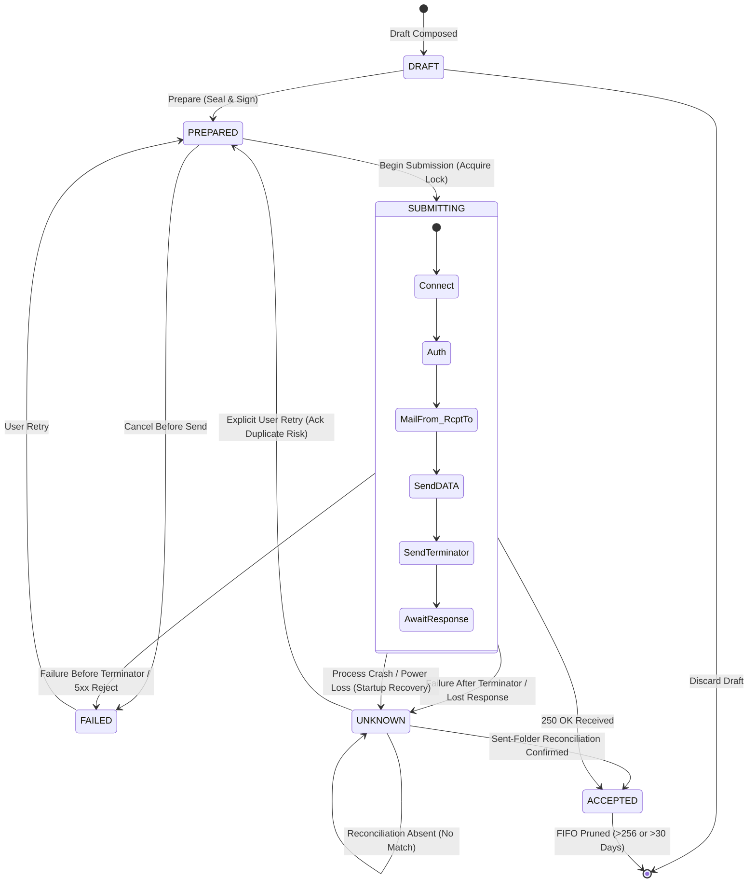

# QuMail M7 — Durable Outbox State Machine, Boundary Safety & Crash Recovery

**Milestone:** M7 — Module 1.6  
**Workstream:** WS-04 — Durable Outbox, Sent-Folder Reconciliation & Delivery Resilience  
**Author:** Antigravity (Implementation Engineer)  
**Reviewer:** ChatGPT (Technical Lead & Security Architect)  
**Project Owner:** Mohammed Uzair Shaikh  
**Date:** 2026-11-09  
**Status:** Approved & Implemented (`codex/m7-module-1-6-ws04`)  

---

## 1. Executive Architecture Overview

QuMail's outbox is designed to be durable, recoverable, and crash-safe across arbitrary process terminations, power cuts, network resets, and ambiguous SMTP outcomes.

### Core Architectural Principles
1. **Never Equate Submission with Delivery:** SMTP server acceptance (`250 OK`) guarantees only that the local mail transfer agent (e.g. Gmail MTA) has received the message into its spool. It does *not* prove that the recipient's endpoint or server has received or decrypted the message. User-facing statuses reflect this strictly.
2. **Crash-Safe Boundary Safety:** All state transitions occur through short, synchronous SQLite transactions within the encrypted account vault. No database locks or open transactions span network operations or socket I/O.
3. **Conservative In-Flight Disconnect Resolution (`UNKNOWN`):** Any failure occurring after the message DATA terminator (`.\r\n`) has been dispatched is treated as potentially accepted by the server. It transitions strictly to `UNKNOWN`.
4. **Mandatory Invariant — Zero Automatic Retry of `UNKNOWN`:** An `UNKNOWN` state represents potential duplicate transmission. It must **never** be resubmitted automatically across application restarts, crash recoveries, background sync loops, or network reconnects.
5. **Explicit Single-Attempt User Authorization:** Transitioning an `UNKNOWN` record back to `PREPARED` requires explicit user acknowledgment of the duplicate-send hazard (`acknowledge_duplicate_risk=True`). Original frozen ciphertext and digests are preserved without re-encryption.
6. **Single-Flight Per-Operation Concurrency Locking:** Per-operation OS file locks (`worker_lock`) prevent multiple workers or threads from simultaneously submitting the same logical message.

---

## 2. State Machine Specification

### 2.1 State Enumeration

| State | Definition | Persistence Location | User-Facing Label (WS-05) | Next Permitted States |
|---|---|---|---|---|
| `DRAFT` | Message composed and saved locally in plaintext. | Vault (`m4_outbox_v1`) | "Draft saved locally" | `PREPARED`, Deleted |
| `PREPARED` | Cryptographic ciphertext generated, digest computed, envelope frozen. | Vault (`m4_outbox_v1`) | "Queued for secure sending" | `SUBMITTING`, `FAILED` (cancel) |
| `SUBMITTING` | Submission in flight; active worker holds lock and socket connection. | Vault (`m4_outbox_v1`) + OS lock | "Sending to mail server..." | `ACCEPTED`, `FAILED`, `UNKNOWN` |
| `ACCEPTED` | Mail server acknowledged receipt (`250 OK`) or verified via Sent folder. | Vault (`m4_outbox_v1`) | "Accepted by your mail server" | Terminal (or Pruned) |
| `UNKNOWN` | Ambiguous outcome: disconnected after `.\r\n` or crash during `SUBMITTING`. | Vault (`m4_outbox_v1`) | "Could not confirm whether this message was sent" | `PREPARED` (explicit retry), `ACCEPTED` (reconciled) |
| `FAILED` | Definitively rejected before acceptance (e.g. 5xx SMTP reject, recipient syntax). | Vault (`m4_outbox_v1`) | "Submission failed" | `PREPARED` (explicit retry) |

### 2.2 State Transition Diagram

---

## 3. Boundary Safety & Failure Mode Analysis

The SMTP submission protocol follows strict boundary enforcement:

| Submission Phase | Event / Error | Assigned Outcome | Assigned State | Rationale |
|---|---|:---:|:---:|---|
| **Pre-Connect** | DNS lookup failure, network offline | `REJECTED` | `FAILED` | Server was never contacted; message definitely not sent. |
| **Pre-TLS / Connect** | Connection refused, timeout | `REJECTED` | `FAILED` | TCP handshake failed; message definitely not sent. |
| **Authentication** | SASL XOAUTH2 rejected (334 / 535) | `REJECTED` | `FAILED` | Authentication failed; message rejected before envelope. |
| **Envelope Routing** | `MAIL FROM` or `RCPT TO` 5xx reject | `REJECTED` | `FAILED` | Policy/recipient rejected; data transfer never started. |
| **DATA Header** | `DATA` command rejected | `REJECTED` | `FAILED` | Server refused to enter data reception mode. |
| **DATA Streaming** | Socket drop *during* message body transfer (before `.\r\n`) | `REJECTED` | `FAILED` | Server discards incomplete DATA blocks without final `.\r\n`. |
| **DATA Terminator** | Final `.\r\n` written to socket buffer | **BOUNDARY** | **BOUNDARY** | Server may parse and commit message immediately upon reading `.\r\n`. |
| **Awaiting Response** | Socket timeout, connection reset, TLS shutdown before `250 OK` | `UNKNOWN` | `UNKNOWN` | Server may have committed message; response packet lost on wire. |
| **Process Crash** | Unexpected SIGKILL, power loss while in `SUBMITTING` | `UNKNOWN` | `UNKNOWN` | Recovered on next launch as `interrupted_acceptance_unknown`. |
| **Successful 250** | `250 2.0.0 OK <id>` received | `ACCEPTED` | `ACCEPTED` | Submission explicitly acknowledged by local MTA. |

---

## 4. Crash Recovery Specification

Upon startup or account selection (`OutboxManager.recover(lease)`):
1. The repository scans `account.records` for any entries whose `state == State.SUBMITTING.value`.
2. For each identified entry:
   - The worker attempts to acquire `ownership(lease.context, operation)`.
   - If `Failure(Error.BUSY)` is raised, an active local worker currently owns the file; the operation is skipped.
   - If acquired, the entry transitions:
     $$\text{state} \leftarrow \text{State.UNKNOWN}$$
     $$\text{reason} \leftarrow \text{"interrupted_acceptance_unknown"}$$
     $$\text{updated\_ts} \leftarrow \text{time.time()}$$
3. **Mandatory Invariant Verification:**
   - Recovery **never** resubmits the message.
   - The operation remains in `UNKNOWN` until either Sent-folder reconciliation confirms acceptance or the user explicitly authorizes a retry.

---

## 5. Explicit Retry Authorization & Duplicate Protection

### 5.1 Retry Semantics
- Retrying an operation in `FAILED` state is safe and permitted without duplicate warning.
- Retrying an operation in `UNKNOWN` state carries inherent risk of duplicate transmission (the remote server may have processed the original send).
- Therefore, `OutboxManager.authorize_retry(lease, operation, acknowledge_duplicate_risk=False)` raises:
  $$\text{Failure}(\text{Error.DUPLICATE})$$
  unless `acknowledge_duplicate_risk=True` is explicitly passed by the caller.

### 5.2 Preservation of Cryptographic Integrity
- Retrying an operation does **not** re-encrypt the draft or generate new ephemeral session keys.
- The original frozen ciphertext bytes, RFC `Message-ID`, and SHA-256 content digest are preserved identically across all retry attempts.
- Maximum attempts per operation is enforced at $\text{MAX\_ATTEMPTS} = 3$. Any attempt beyond 3 raises $\text{Failure}(\text{Error.LIMIT})$.

---

## 6. Single-Flight Concurrency Protection

To guarantee that multiple background workers, UI threads, or concurrent application instances cannot dispatch duplicate messages:
- Every submission begins with `with repository.ownership(context, operation):`.
- Uses Win32 non-blocking file locking (`msvcrt.locking(fileno, msvcrt.LK_NBLCK, 1)`) on Windows and POSIX `fcntl.flock(fileno, LOCK_EX | LOCK_NB)` on Unix.
- If a lock cannot be acquired immediately, the call raises `Failure(Error.BUSY)`.
- Locks are released cleanly upon exit or abnormal process termination by the operating system kernel.
